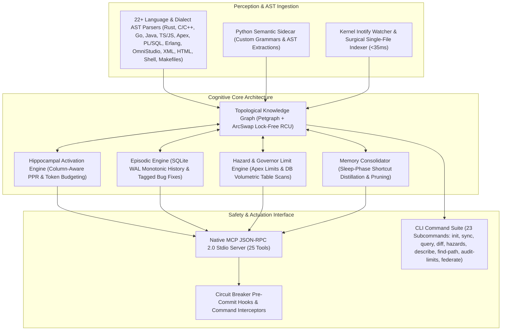
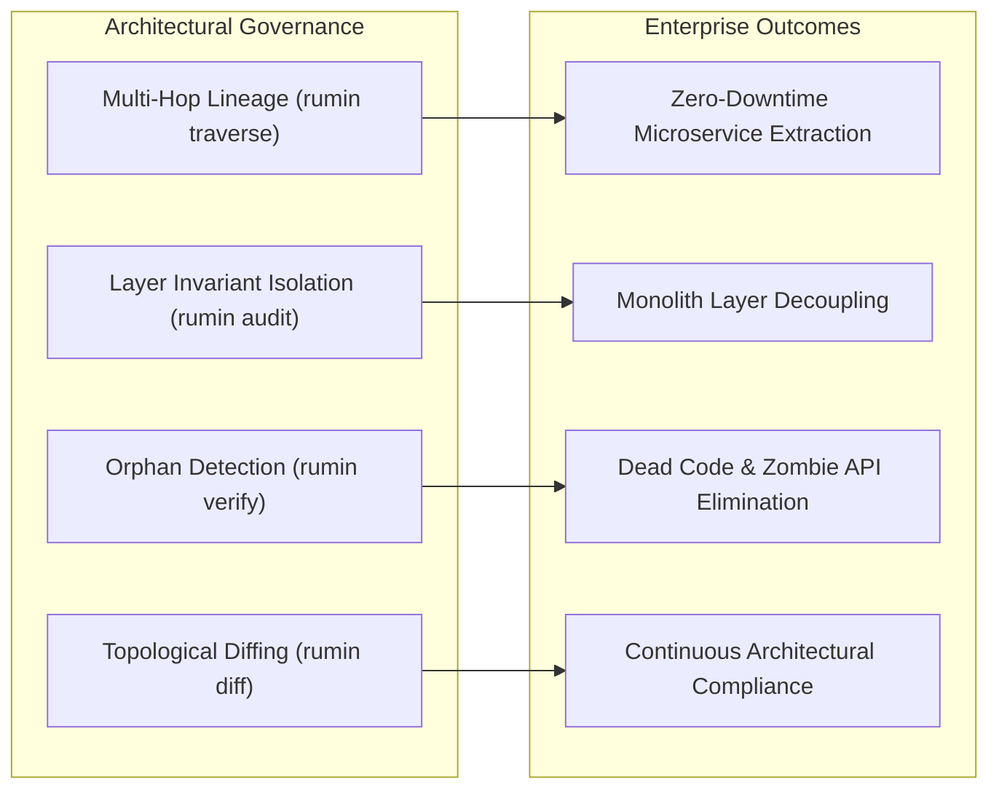
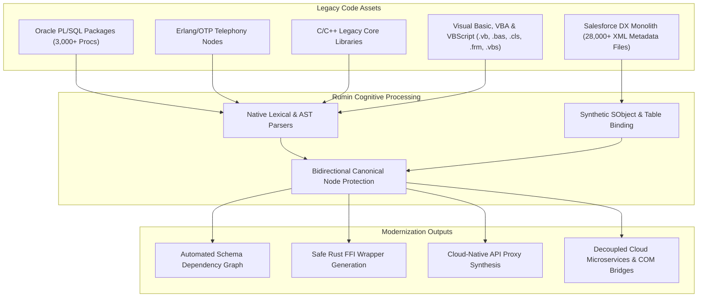
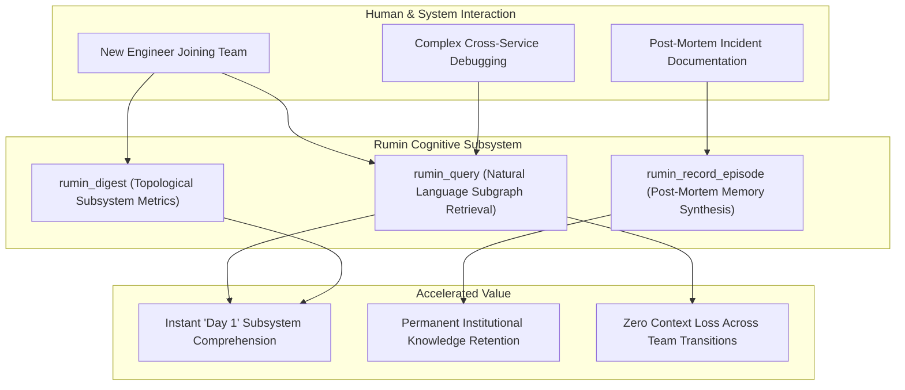
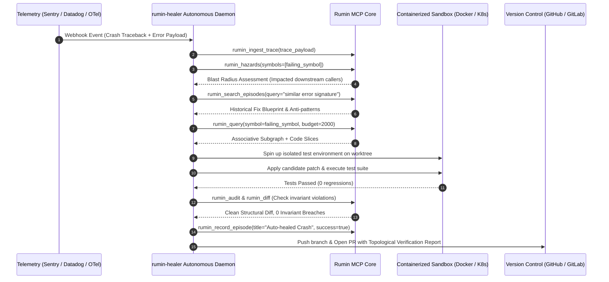
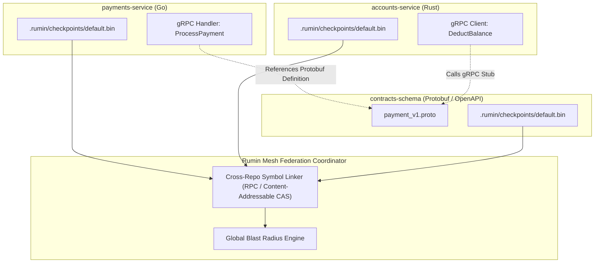

# The Rumin Cognitive Code-Memory Engine: Comprehensive Use Cases & Visionary Capabilities

> **Document Type**: Comprehensive Architectural & Operational Use Case Encyclopedia  
> **System**: `ai-rumin` / `air-mem` (High-Performance Rust Core + Python Semantic Sidecar + SQLite Episodic Engine)  
> **Status**: Living Reference & Capabilities Catalog  
> **Scope**: Autonomous AI Agents, Enterprise Architecture, Systems Governance, DevSecOps, and Next-Gen Self-Healing Software  

---

## Executive Vision: From Stateless Code Search to Associative Cognitive Memory

Traditional developer tooling and LLM coding assistants operate statelessly:
1. **Naive lexical/keyword search (grep, ripgrep)** lacks topological awareness of callers, callees, inheritance, and contracts.
2. **Brute-force context stuffing (dumping 100k tokens into LLMs)** is cost-prohibitive, triggers LLM needle-in-a-haystack attention degradation, and violates strict token circuit breakers.
3. **Isolated vector embeddings** miss exact deterministic graph relationships (e.g. cross-file trait implementations, database schemas, foreign keys, and API gateway routing).
4. **Zero episodic retention**: Every prompt turn starts with amnesia. If an agent tries a patch that fails, it has no persistent cognitive mechanism to prevent repeating the identical mistake across turns or sessions.

**Rumin fundamentally shifts software engineering from stateless querying to biological-inspired cognitive memory**:
- **Hippocampal Associative Activation**: Employs Personalized PageRank (PPR) spreading activation over a high-capacity multi-language topological code graph (`petgraph`) to deliver sub-second associative context under strict token budgets.
- **Episodic Long-Term Memory**: Stores past debugging trials, architectural blueprints, lessons, and outcomes in SQLite WAL (`memory.db`), cross-linking them as synthetic nodes directly into the code graph.
- **Topological Hazard & Blast Radius Engine**: Dynamically calculates directional ripple effects before code modifications occur.
- **Sleep-Phase Consolidation**: Distills multi-hop pathways into direct shortcut edges and prunes dead transient hypotheses.
- **Lock-Free Concurrency & Real-Time Watching**: Utilizes RCU (`ArcSwap`) snapshotting and OS kernel inotify event streams to keep the cognitive graph live with 0% idle CPU and zero read contention.



---

## Table of Contents

1. [Autonomous AI Coding Agents & Pair Programming](#1-autonomous-ai-coding-agents--pair-programming)
   - 1.1. Zero-Shot Context Assembly for Ultra-Large Codebases (30,000+ Files)
   - 1.2. Multi-Turn Episodic Debugging & "Never Make the Same Mistake Twice"
   - 1.3. Multi-Agent Swarm Collaboration with Shared Cognitive Memory
   - 1.4. Pre-Edit Blast Radius & Hazard Mitigation
   - 1.5. Tool Execution Trace Ingestion & Behavioral Telemetry
   - 1.6. Real-Time Sub-50ms Surgical Edit-and-Verify Loops (`rumin_index_file`)
   - 1.7. Zero-Shot Symbol & Schema Introspection (`rumin_describe`)
   - 1.8. Directed Multi-Hop Causal Pathfinding (`rumin_find_path`)
2. [Enterprise Architectural Governance & Monolith Modernization](#2-enterprise-architectural-governance--monolith-modernization)
   - 2.1. Monolith-to-Microservices Decomposition & Domain Boundary Discovery
   - 2.2. Architectural Layer Invariant Auditing (`rumin_audit`)
   - 2.3. Dead Code, Orphaned Interfaces & Zombie Dependency Removal (`rumin_verify`)
   - 2.4. Polyglot Multi-Tier System Graphing
   - 2.5. Runtime Governor Limits & Concurrency Hazard Governance (`rumin_audit_limits`)
   - 2.6. OmniStudio & Enterprise Integration Procedure Governance
   - 2.7. Cross-Enterprise Multi-Repository Federation (`rumin_federate_repo`)
3. [Developer Experience, IDEs & Continuous Integration (CI/CD)](#3-developer-experience-ides--continuous-integration-cicd)
   - 3.1. Instant IDE Code Navigation with Zero Read-Lock Contention
   - 3.2. PR Blast Radius Reporting & Topological Diffing in CI/CD
   - 3.3. Pre-Commit Safety Circuit Breakers (`rumin hook`)
   - 3.4. Sleep-Phase Memory Consolidation (The "Dream Phase")
4. [Legacy Codebases & Complex Domain Modernization](#4-legacy-codebases--complex-domain-modernization)
   - 4.1. Enterprise Salesforce Org Remediation (SFDX, SObjects & Granular SOQL)
   - 4.2. Oracle & Multi-Dialect SQL/PLSQL Stored Procedure Refactoring
   - 4.3. Erlang/OTP Distributed Actor Topology Mapping
   - 4.4. C/C++ to Memory-Safe Rust Modernization
   - 4.5. Multi-Dialect Enterprise Database Harmonization & Heuristic FK Recovery
   - 4.6. OmniStudio, Integration Procedures & CPQ Modernization
   - 4.7. Visualforce & Aura to LWC Migration Intelligence
5. [Security, Threat Modeling & DevSecOps](#5-security-threat-modeling--devsecops)
6. [Organizational Engineering Intelligence & Team Onboarding](#6-organizational-engineering-intelligence--team-onboarding)
7. [Autonomous Self-Healing & Self-Evolving Code Systems (Sky-Is-The-Limit)](#7-autonomous-self-healing--self-evolving-code-systems-sky-is-the-limit)
8. [Concrete Enterprise Scenarios & Implementation Walkthroughs](#8-concrete-enterprise-scenarios--implementation-walkthroughs)
   - Scenario A: The Telecom Monolith Bug Hunt
   - Scenario B: Enterprise Siebel & Oracle DDL Data Dictionary Audit & High-Volume Table Scan Mitigation
   - Scenario C: OmniStudio Integration Procedure to Apex Refactoring with Sub-IP Call Flow
   - Scenario D: Multi-Repository Cross-Service Breaking Change Prevention via Federation
9. [Comprehensive MCP Tool & CLI Capabilities Matrix (25 Tools)](#9-comprehensive-mcp-tool--cli-capabilities-matrix)
10. [Autonomous Self-Healing Daemon Architecture (rumin-healer Blueprint)](#10-autonomous-self-healing-daemon-architecture-rumin-healer-blueprint)
11. [Federated Multi-Repository Cognitive Mesh (rumin-federation)](#11-federated-multi-repository-cognitive-mesh-rumin-federation)
    - 11.1. Cross-Repository Symbol Addressing
    - 11.2. Cross-Service Breaking Change Prevention
    - 11.3. Dynamic Multi-Repository Federation Protocol (`rumin_federate_repo`)
12. [Cognitive Language Server Protocol (LSP) & Next-Gen IDE Integration](#12-cognitive-language-server-protocol-lsp--next-gen-ide-integration)
13. [Mathematical & Algorithmic Foundations](#13-mathematical--algorithmic-foundations)
    - 13.1. Personalized PageRank Formulation on Directed Code Multigraphs
    - 13.2. Context Subgraph Extraction under Token Budget Constraint
    - 13.3. Directional Hazard & Blast Radius Attenuation
    - 13.4. Volumetric Database Hazard Attenuation
    - 13.5. Column-Level Personalized PageRank Amplification
14. [Custom Language & AST Grammar Extensibility Guide](#14-custom-language--ast-grammar-extensibility-guide)

---

## 1. Autonomous AI Coding Agents & Pair Programming

### 1.1. Zero-Shot Context Assembly for Ultra-Large Codebases (30,000+ Files)
* **The Problem**: In repositories with millions of lines of code (such as enterprise Salesforce orgs, Linux kernel trees, or massive mono-repos), providing context to an LLM via keyword search misses transitive dependencies, while dumping entire files causes context window overflow and high inference costs.
* **How Rumin Solves It**:
  - `rumin_query(query="SyncAutoTask billing failure", budget=1500)`
  - Rumin identifies candidate seed symbols through token and signature matching.
  - Personalized PageRank (PPR) spreads probability mass across directional edges (`Calls`, `DependsOn`, `Inherits`, `Contains`, `References`).
  - Strict token budgeting expands only the top structural subgraphs, returning the exact 3–5 critical interacting classes and methods within <500ms.
* **Key Tools**: `rumin_query`, `rumin_digest`.

### 1.2. Multi-Turn Episodic Debugging & "Never Make the Same Mistake Twice"
* **The Problem**: Autonomous coding agents often enter cyclic trial-and-error loops—trying patch approach A, failing a test, attempting patch B, failing, and then attempting patch A again.
* **How Rumin Solves It**:
  - During a debugging session, the agent records trials:
    ```bash
    rumin record-episode \
      --title "Fix Mutex Poisoning in SQLite Reader" \
      --content "Tried replacing Mutex with RwLock; deadlocked due to re-entrant read inside transaction. Reverted and used poisoned recovery .into_inner()." \
      --success false \
      --symbols "MemoryDb::conn,MemoryDb::execute" \
      --files "src/db.rs" \
      --tags "concurrency,sqlite,deadlock"
    ```
  - When the agent encounters a related bug later, `rumin_search_episodes` or `rumin_query` surfaces this past failure directly in the prompt context before any edits are made.
* **Key Tools**: `rumin_record_episode`, `rumin_search_episodes`, `rumin_query`.

### 1.3. Multi-Agent Swarm Collaboration with Shared Cognitive Memory
* **The Problem**: In multi-agent swarms (e.g. Lead Architect Agent + Frontend Agent + Backend Agent + QA Debugger Agent), agents run in isolated processes and do not share working scratchpads or hypotheses.
* **How Rumin Solves It**:
  - Agents share a single `ai-rumin serve` instance or common `.rumin/` database.
  - Subagents create and inspect sessions (`rumin_session_create`, `rumin_session_inspect`).
  - Intermediate findings are posted via `rumin_add_working_note(session_id="...", content="Refactored trait DBStorage; waiting for migration run")`.
  - When a subagent finishes, the parent or sibling agent inspects the session to pick up the exact train of thought without loss of state.
* **Key Tools**: `rumin_session_create`, `rumin_session_list`, `rumin_session_inspect`, `rumin_add_working_note`.

### 1.4. Pre-Edit Blast Radius & Hazard Mitigation
* **The Problem**: An AI agent modifying a function signature or database column in `src/models/user.rs` has no intrinsic awareness of the 45 downstream controllers, cron workers, and microservices that call it, causing regressions.
* **How Rumin Solves It**:
  - Before modifying a symbol, the agent calls:
    `rumin_hazards(symbols=["models::User::calculate_balance"])`
  - Rumin computes the forward reachability closure across `Calls` and `DependsOn` edges, classifying impacted symbols into `high_risk` (immediate callers), `medium_risk` (transitive callers within 2 hops), and `low_risk`.
  - The agent is warned before touching high-risk symbols and automatically expands its test plan to cover the impacted blast radius.
* **Key Tools**: `rumin_hazards`, `rumin_traverse`.

### 1.5. Tool Execution Trace Ingestion & Behavioral Telemetry
* **The Problem**: Coding agents generate verbose command outputs, test run outputs, and compiler error logs that quickly get lost across sessions.
* **How Rumin Solves It**:
  - Execution traces in JSONL format are fed directly into Rumin:
    `rumin_ingest_trace(trace_path="logs/trajectory_042.jsonl", session_id="ses_debug_12")`
  - Rumin parses step frequencies, touched files, and error patterns into SQLite, correlating behavioral traces with structural code entities.
* **Key Tools**: `rumin_ingest_trace`.

### 1.6. Real-Time Sub-50ms Surgical Edit-and-Verify Loops (`rumin_index_file`)
* **The Problem**: In repositories with 30,000+ files, running a full incremental scan or index rebuild after an AI agent edits a single method takes 5–15 seconds, creating interactive lag, breaking conversational flow, and causing agent timeout errors.
* **How Rumin Solves It**:
  - Immediately following a file edit, the agent calls:
    `rumin_index_file(file_path="force-app/main/default/classes/OrderService.cls")`
  - Or via CLI: `rumin sync --file force-app/main/default/classes/OrderService.cls`
  - In sub-35ms, Rumin parses the modified file, updates the AST nodes, re-wires all incoming and outgoing edges, updates the Blake3 manifest entry, and updates the in-memory graph without scanning any other file on disk.
* **Key Tools**: `rumin_index_file`, `rumin_sync`.

### 1.7. Zero-Shot Symbol & Schema Introspection (`rumin_describe`)
* **The Problem**: Agents need to understand the full signature, docstring, child fields, method implementations, and exact relationship topology of a symbol without wasting tokens reading 3,000–5,000 line source files.
* **How Rumin Solves It**:
  - The agent calls `rumin_describe(entity_name="Account")` or `rumin describe SIEBEL.S_ASSET`.
  - Rumin returns a clean, structured JSON object containing:
    - Entity metadata (table name, schema, recorded row counts, kind).
    - Child columns/fields with data types and constraints.
    - Public and private methods with signatures.
    - Complete incoming caller list and outgoing dependencies.
* **Key Tools**: `rumin_describe`.

### 1.8. Directed Multi-Hop Causal Pathfinding (`rumin_find_path`)
* **The Problem**: When triaging cross-layer bugs or planning migrations, agents struggle to determine how execution flows between distant architectural components (e.g. "How does an HTTP event in `CheckoutController` reach `PaymentGateway`?").
* **How Rumin Solves It**:
  - The agent invokes:
    `rumin_find_path(source_symbol="CheckoutController", target_symbol="PaymentGateway", max_depth=5)`
  - Rumin executes a bounded depth-first simple path traversal across `Calls`, `DependsOn`, `References`, and `Implements` edges, returning the ordered symbol path:
    `CheckoutController -> OrderService::submit -> PaymentAdapter -> PaymentGateway`
* **Key Tools**: `rumin_find_path`, `rumin_traverse`.

---

## 2. Enterprise Architectural Governance & Monolith Modernization



### 2.1. Monolith-to-Microservices Decomposition & Domain Boundary Discovery
* **The Problem**: Breaking down a 15-year-old monolithic enterprise backend into domain-driven microservices is traditionally a multi-month manual effort fraught with circular dependency traps.
* **How Rumin Solves It**:
  - Rumin parses all modules, classes, and tables into a connected graph.
  - Using `rumin_traverse(direction="callers", depth=4)` and `rumin_digest`, architects identify high-cohesion clusters and tightly coupled cross-boundary bridges.
  - Rumin identifies "god classes" and database tables shared across multiple business domains, allowing teams to design clean event-driven interfaces before writing a line of refactoring code.

### 2.2. Architectural Layer Invariant Auditing (`rumin_audit`)
* **The Problem**: Enterprise architectures enforce strict layer boundaries (e.g., *Controllers must never directly query Database Tables without going through Repositories/Services*; *Frontend UI must not reference Backend internal utilities*). Developers routinely violate these boundaries unintentionally.
* **How Rumin Solves It**:
  - `rumin audit` executes rule-based graph queries across node types:
    ```bash
    cargo run -- audit
    ```
  - It detects illegal edge kinds (e.g. `Controller --[DependsOn]--> Table` without intermediate `Service`).
  - Violations are reported with exact line numbers and qualified symbol IDs, allowing CI/CD gatekeeping.
* **Key Tools**: `rumin_audit`, `rumin_verify`.

### 2.3. Dead Code, Orphaned Interfaces & Zombie Dependency Removal (`rumin_verify`)
* **The Problem**: Over years of development, hundreds of unused endpoints, deprecated utility classes, and orphaned database models clutter the codebase, slowing down builds and introducing security vulnerabilities.
* **How Rumin Solves It**:
  - `rumin_verify` runs structural graph analysis:
    - Finds classes and interfaces with zero incoming references or implementations.
    - Identifies Apigee `ProxyEndpoint` definitions lacking a route rule to a valid `TargetEndpoint`.
    - Discovers dangling method implementations whose interfaces have been removed.
* **Key Tools**: `rumin_verify`.

### 2.4. Polyglot Multi-Tier System Graphing
* **The Problem**: Modern enterprise systems rarely use a single language. A single transaction may cross:
  - Salesforce Apex / Aura / LWC
  - Apigee API Gateway XML proxies & policy rules
  - Java Spring Boot microservices
  - Oracle PL/SQL stored procedures & packages
  - Python data workers & Shell deploy scripts
* **How Rumin Solves It**:
  - Rumin's parser engine natively binds all these technologies into a single unified knowledge graph:
    `LWC JS Component -> Apigee XML Proxy -> Java Controller -> Oracle PL/SQL Package -> Database Column`.
  - Traversing downstream through `rumin_traverse` traces requests across language boundaries in a single query.
* **Key Tools**: `rumin_traverse`, `rumin_digest`.

### 2.5. Runtime Governor Limits & Concurrency Hazard Governance (`rumin_audit_limits`)
* **The Problem**: Multi-tenant cloud ecosystems (such as Salesforce multi-tenant runtimes) and high-throughput transactional database engines enforce strict governor limits (e.g., maximum 100 SOQL queries per transaction, maximum 150 DML statements, 10-second CPU limits, and table-lock timeouts). Traditional static analyzers fail to detect queries or DML operations nested within loops, recursive method invocations, or full-table scans across multi-million-row enterprise tables.
* **How Rumin Solves It**:
  - `rumin_audit_limits` (and CLI `rumin audit-limits`) systematically traverses AST and graph edges to detect:
    1. **SOQL Inside Loops (`LoopSOQL`)**: Highlights SOQL queries executed within `for`, `while`, or `do-while` loops (e.g. `[SELECT Id, Name FROM Contact WHERE AccountId = :acc.Id]`), which immediately breach the 100-query governor limit in bulk execution.
    2. **DML Inside Loops (`LoopDML`)**: Identifies `insert`, `update`, `delete`, or `upsert` statements executed per record instead of batch collection DML.
    3. **Unindexed Table Scan Hazards (`UnindexedTableScan`)**: In database DDL models, identifies large-scale queries filtering or joining on non-indexed columns against volumetric tables (e.g. Siebel `S_ASSET_XA` with 19.8M rows or `S_ORDER_ITEM` with 64.7M rows).
  - Provides instant remediation guidance (e.g., set-based bulkification patterns, custom index creation recommendations).
* **Key Tools**: `rumin_audit_limits`, `rumin_hazards`.

### 2.6. OmniStudio & Enterprise Integration Procedure Governance
* **The Problem**: Large-scale communications and utility enterprises deploy hundreds of Salesforce OmniStudio Integration Procedures (`.oip-meta.xml`), OmniScripts (`.os-meta.xml`), and Omnichannel Card layouts (`.ouc-meta.xml`). These declarative JSON-in-XML artifacts frequently embed unvalidated remote Apex action calls, hardcoded HTTP endpoints, missing DataRaptor mappings, and unhandled sub-IP circular execution chains.
* **How Rumin Solves It**:
  - Rumin parses OmniStudio metadata natively:
    - Extracts `OmniProcess` elements and maps `IntegrationProcedure` sub-action calls into directed `Calls` edges.
    - Bridges declarative `RemoteAction` references to actual Apex classes and method signatures.
    - Resolves `DataRaptorExtractAction` and `DataRaptorPostAction` dependencies against underlying SObjects and Custom Metadata (`.md-meta.xml`).
  - Flagging missing remote handlers or orphan sub-procedures before sandbox deployment:
    ```bash
    cargo run -- verify
    ```
* **Key Tools**: `rumin_verify`, `rumin_describe`, `rumin_traverse`.

### 2.7. Cross-Enterprise Multi-Repository Federation (`rumin_federate_repo`)
* **The Problem**: Enterprise architectures are rarely confined to a single git repository. A complete business workflow may span a Salesforce core repo (`SF-B2B`), an Apigee gateway proxy repo (`apigee-proxies`), a backend payment microservice (`payment-svc`), and legacy Oracle database migration scripts (`db-schema`). Agents running inside one repository are blind to cross-repo dependencies and can inadvertently introduce breaking API contracts.
* **How Rumin Solves It**:
  - Rumin supports dynamic multi-repository federation via `rumin_federate_repo` (and CLI `rumin federate --alias <name> <path>`):
    ```json
    {
      "repo_path": "/home/org/dev/payment-svc",
      "alias": "payment_service"
    }
    ```
  - Rumin ingests and prefixes the remote repository's graph into the local memory mesh with qualified namespaces (e.g. `payment_service::PaymentGateway`).
  - Cognitive queries (`rumin_query`, `rumin_find_path`) seamlessly traverse across repositories to verify end-to-end contract compatibility without duplicating storage or merging git repositories.
* **Key Tools**: `rumin_federate_repo`, `rumin_switch_repo`, `rumin_find_path`.

---

## 3. Developer Experience, IDEs & Continuous Integration (CI/CD)

### 3.1. Instant IDE Code Navigation with Zero Read-Lock Contention
* **The Problem**: Traditional language servers (LSP) re-index on every keystroke, causing high CPU usage and lock contention that freezes editor auto-complete.
* **How Rumin Solves It**:
  - Rumin implements **RCU (`ArcSwap`) lock-free snapshots**:
    - Editor plugins reading from `rumin` via MCP execute with $O(1)$ pointer acquisition.
    - Background incremental sync runs completely decoupled in a separate thread.
    - Zero lock contention ensures sub-10ms response times for symbol lookups and code navigation.
* **Key Tools**: `rumin_query`, `rumin_traverse`.

### 3.2. PR Blast Radius Reporting & Topological Diffing in CI/CD
* **The Problem**: Pull request reviews in GitHub or GitLab rely on line-based `git diff`. Reviewers cannot easily see which downstream systems or public APIs are affected by a changed function.
* **How Rumin Solves It**:
  - In CI/CD pipelines, `ai-rumin diff --checkpoint .rumin/checkpoints/base.bin` computes the structural delta:
    ```
    === TOPOLOGICAL GRAPH DIFF ===
    + Added Entities: 14
    ~ Modified Entities: 3
    - Removed Entities: 1
    + Added Edges: 22
    - Removed Edges: 4
    ```
  - Combined with `rumin hazards`, CI automatically posts a bot comment on the PR detailing the exact blast radius and risk rating (`high_risk` vs `low_risk`).
* **Key Tools**: `rumin_diff`, `rumin_hazards`.

### 3.3. Pre-Commit Safety Circuit Breakers (`rumin hook`)
* **The Problem**: AI coding agents operating autonomously in IDEs or CLI terminals can inadvertently run destructive commands (`git reset --hard`, `DROP TABLE`, `rm -rf /`) or dump 5,000 lines of file text into an LLM prompt.
* **How Rumin Solves It**:
  - `rumin hook install` installs a non-destructive pre-commit safety hook with automatic backup (`pre-commit.rumin.bak`).
  - `CircuitBreaker::check_slice(lines, limit)` enforces maximum view slicing thresholds (blocking waste).
  - `CircuitBreaker::check_command(command)` blocks high-hazard terminal commands instantly.
* **Key Tools**: `rumin_hook`.

### 3.4. Sleep-Phase Memory Consolidation (The "Dream Phase")
* **The Problem**: Over weeks of agentic pair-programming and refactoring, thousands of temporary nodes, scratchpad entities, and exploratory trial nodes accumulate.
* **How Rumin Solves It**:
  - When the developer or agent finishes work (or via a scheduled nightly cron job), `rumin_consolidate` runs:
    - Prunes orphaned temporary entities (`temp::*`, `.tmp*`).
    - Synthesizes 2-hop transitive paths ($A \to B \to C$) into direct distilled shortcut edges ($A \to C$).
    - Automatically persists a compacted binary checkpoint (`default.bin`).
* **Key Tools**: `rumin_consolidate`, `rumin_checkpoint`.

---

## 4. Legacy Codebases & Complex Domain Modernization



### 4.1. Enterprise Salesforce Org Remediation (SFDX, SObjects & Granular SOQL)
* **The Problem**: Large enterprise Salesforce environments contain thousands of Apex classes, triggers, and metadata XML files (`force-app/main/default/`). Circular trigger handler logic and untracked SObject field references frequently cause deployment blockers.
* **How Rumin Solves It**:
  - Rumin natively extracts custom objects (`sobject::Account`), custom fields (`Account::field::BillingCountry`), Custom Metadata (`.md-meta.xml`), Apex classes, and methods.
  - Automatically filters out deployment metadata noise (`*.cls-meta.xml`, `*.fieldTranslation-meta.xml`), preserving only semantic schema and code nodes.
  - Tracks trigger-to-handler execution flows and maps granular SOQL query field targets to prevent field-deletion regression.

### 4.2. Oracle PL/SQL Stored Procedure & Package Refactoring
* **The Problem**: Banking and telecommunications platforms often have hundreds of thousands of lines of PL/SQL packages with complex procedural inter-dependencies, package bodies, and standalone functions.
* **How Rumin Solves It**:
  - Rumin's native Rust PL/SQL parser extracts `PACKAGE`, `PACKAGE BODY`, `PROCEDURE`, `FUNCTION`, `TRIGGER`, `TYPE`, `SEQUENCE`, `TABLE`, and `VIEW` definitions.
  - Links package members via `EdgeKind::Contains` to their parent package namespaces.
  - Automatically connects SQL queries and DDL schemas into the same graph as API controllers.

### 4.3. Erlang/OTP Distributed Actor Topology Mapping
* **The Problem**: Erlang systems rely on message passing, behavior modules (`gen_server`, `supervisor`), and application specifications (`.app.src`, `rebar.config`), which standard LSP tools cannot cross-link effectively.
* **How Rumin Solves It**:
  - Rumin parses Erlang modules, exports (`-export([run/1, init/1])`), record definitions in `.hrl` files, and supervisor trees.
  - Enables agents to trace actor communication graphs and OTP application dependency hierarchies.

### 4.4. C/C++ to Memory-Safe Rust Modernization
* **The Problem**: Migrating critical C/C++ systems to Rust requires understanding pointer passing conventions, struct definitions, and deep header inclusion trees.
* **How Rumin Solves It**:
  - Rumin parses C/C++ struct definitions, functions, and `#include` hierarchies into the graph.
  - Agents map out C struct layouts and build equivalent Rust types with automated safety boundary analysis.

### 4.5. Multi-Dialect Enterprise Database Harmonization & Heuristic FK Recovery
* **The Problem**: Enterprise databases accumulate schemas across diverse RDBMS dialects over decades—PostgreSQL, MySQL with backtick escaping, SQLite, and legacy Oracle/Siebel DDLs. In systems like Oracle Siebel CRM, foreign keys are almost never defined as explicit SQL `FOREIGN KEY` constraints in DDL scripts; instead, relationships exist purely as naming conventions (e.g., `BU_ID` references `S_BU.ROW_ID`, `ACCNT_ID` or `PR_OU_ID` references `S_ORG_EXT.ROW_ID`). Standard SQL parsers produce disconnected islands of tables, losing the relational graph.
* **How Rumin Solves It**:
  - **Universal DDL Parser**: Handles Oracle, PostgreSQL, MySQL (with backtick identifier handling: `` `id` ``, `` `user_id` ``), and SQLite tables, indexes, and primary keys.
  - **Volumetric Metadata Ingestion**: Parses volumetric table header comments (e.g. `-- Volumetric: 19,800,000 rows` or `ROWS: 64.7M`) directly into entity metadata for hazard calculation.
  - **Heuristic Foreign Key Recovery Engine**:
    - Scans unlinked column identifiers ending in `_ID`, `_OU_ID`, or `_BU_ID`.
    - Automatically infers and creates directed `EdgeKind::References` edges to target entity tables (e.g., mapping `S_ASSET.BU_ID -> S_BU` and `S_ORDER.ACCNT_ID -> S_ORG_EXT`).
    - Recovers the full relational topology of legacy enterprise schemas without requiring DBA intervention.
* **Key Tools**: `rumin_index`, `rumin_traverse`, `rumin_describe`.

### 4.6. OmniStudio, Integration Procedures & CPQ Modernization
* **The Problem**: Telecommunications, healthcare, and financial services Salesforce orgs heavily utilize Salesforce Industries (Vlocity) OmniStudio. High-frequency CPQ (Configure, Price, Quote) logic, VIP calculation procedures, and Omnichannel cart actions reside in deeply nested JSON XML payloads (`.oip-meta.xml`). Refactoring an underlying Apex pricing service or SObject custom field often breaks OmniStudio Integration Procedures silently at runtime with zero compilation warnings.
* **How Rumin Solves It**:
  - Rumin's OmniStudio parser parses `.oip-meta.xml`, `.os-meta.xml`, and `.ouc-meta.xml` metadata files.
  - Extracts sub-procedures (`Type_SubType` identifiers) and maps invocation flows (`IntegrationProcedureAction`).
  - Connects CPQ calculations and remote action methods directly to backend Apex classes (e.g. `B2BCmexAppHandler`, `PricingCalculationService`).
  - When modifying an Apex pricing method, agents query `rumin_traverse(symbol_id="PricingCalculationService::calculatePrice", direction="callers")` to instantly discover all caller Integration Procedures and OmniScripts before committing code.
* **Key Tools**: `rumin_traverse`, `rumin_find_path`, `rumin_describe`.

### 4.7. Visualforce & Aura to LWC Migration Intelligence
* **The Problem**: Enterprise Salesforce teams face massive migration mandates: transitioning hundreds of legacy Visualforce pages (`.page`, `.component`) and Aura component bundles (`.cmp`, `.app`, helper JS, controller JS) to modern Lightning Web Components (LWC). Mapping stateful Visualforce controller bindings, `<apex:actionFunction>` hooks, and Aura `<aura:attribute>` event emissions to reactive LWC JavaScript and HTML templates is tedious and error-prone.
* **How Rumin Solves It**:
  - **Visualforce Parser**: Extracts apex controller bindings, `<apex:includeScript>` assets, extension classes, and page parameters.
  - **Aura Bundle Parser**: Maps `.cmp` component markup, client-side controller JS functions, and helper closures into a unified component hierarchy.
  - **Migration Graph**: Links Visualforce / Aura components directly to the Apex classes and SObject fields they consume.
  - AI agents use Rumin to generate 100% feature-complete LWC replacements, verifying that every Apex controller method and SObject field consumed by the legacy page is properly wired via `@wire` or imperative Apex calls in the new LWC component.
* **Key Tools**: `rumin_query`, `rumin_traverse`, `rumin_verify`.

### 4.8. Legacy Visual Basic (VB6, VBA & VB.NET) to Cloud-Native Modernization
* **The Problem**: Global enterprises in financial services, insurance, logistics, and healthcare run billions of dollars of operational workflows on mission-critical Visual Basic 6.0 client applications, Excel/Access VBA macros, and early VB.NET monoliths. These codebases are opaque, lack automated tests, and are tightly coupled to Windows COM automation (`ADODB.Recordset`, `Excel.Application`, `MSXML2.DOMDocument`, `Scripting.FileSystemObject`) and Win32 DLL P/Invoke routines. Migrating them to modern Linux microservices (Rust, Go, Python) or browser-based cloud architectures is traditionally stalled by unknown dependency boundaries.
* **How Rumin Solves It**:
  - **Full Dialect Spectrum Ingestion**: Natively indexes VB.NET (`.vb`), VBA Standard Modules (`.bas`), Class Modules (`.cls`), UserForms (`.frm`), ActiveX UserControls (`.ctl`), and VBScript (`.vbs`).
  - **Smart `.cls` Disambiguation**: Differentiates Visual Basic Class Modules from Salesforce Apex classes sharing the `.cls` extension with zero false positives.
  - **Automated COM & ActiveX Dependency Mapping**: Scans both early-bound (`Set conn = New ADODB.Connection`) and late-bound (`CreateObject("Excel.Application")`) instantiations, producing canonical `com::<ProgID>` nodes and directed `References` edges.
  - **Win32 DLL P/Invoke Audit**: Surfaces all 32/64-bit external library declarations (`Declare PtrSafe Function ... Lib "user32"`), exposing OS-level dependencies.
  - **Deterministic Transpilation & Microservice Extraction**: Autonomous coding agents leverage `rumin_find_path` and `rumin_describe` to trace entire business logic flows, mapping legacy UserForm event handlers and procedural subroutines directly into decoupled modern REST/gRPC endpoints.
* **Key Tools**: `rumin_index`, `rumin_query`, `rumin_traverse`, `rumin_find_path`, `rumin_describe`.

---

## 5. Security, Threat Modeling & DevSecOps

### 5.1. Toxic Dependency & CVE Reachability Analysis
* **The Problem**: Traditional Software Bill of Materials (SBOM) scanners flag any repository using a vulnerable package version (e.g. `lodash < 4.17.21`), even if the vulnerable function is never invoked in the codebase. This causes high alert fatigue.
* **How Rumin Solves It**:
  - Rumin tracks external imports (`rust::std::sync::Arc`, `py::os`, `go::fmt`, `java::org.apache.*`).
  - When a vulnerability advisory specifies a flawed function `pkg::vulnerable_func`, Rumin runs `rumin_traverse(symbol_id="pkg::vulnerable_func", direction="callers")`.
  - If the path from entrypoint to the flawed symbol is unreachable, the risk is classified as low or benign; if a path exists, Rumin prints the exact multi-hop call chain demonstrating exploitability.

### 5.2. Sensitive Data & PII Variable Lineage
* **The Problem**: Compliance regulations (GDPR, HIPAA, PCI-DSS) prohibit logging or unencrypted transit of personally identifiable information (PII) such as credit card numbers or national IDs.
* **How Rumin Solves It**:
  - Rumin maps database columns (`sobject::Account::Tax_Id__c`, SQL column `users.ssn`) and tracks references downstream to logger calls and API serializers.
  - Flags hazard paths where PII fields flow into un-sanitized logging frameworks.

### 5.3. Autonomous Agent Sandbox Containment
* **The Problem**: AI agents with terminal command execution capabilities can inadvertently execute catastrophic shell commands.
* **How Rumin Solves It**:
  - Integrated circuit breaker hooks intercept commands before shell invocation.
  - Patterns like `rm -rf *`, `git push --force`, `dd if=/dev/zero`, and raw un-parameterized SQL drop scripts are rejected deterministically before execution.

---

## 6. Organizational Engineering Intelligence & Team Onboarding



### 6.1. "Day 1" Engineering Onboarding Assistant
* **The Problem**: A new engineer joins a team with a 500,000-line codebase. It typically takes 2–4 weeks to build a mental model of how authentication, data ingestion, and billing pipelines interconnect.
* **How Rumin Solves It**:
  - The engineer asks natural language questions via an AI chat connected to Rumin MCP:
    *"How does a webhook order event get processed and saved to the database?"*
  - `rumin_query` surfaces the exact subgraph connecting the HTTP route handler, the verification middleware, the queue producer, the worker consumer, and the database schema.
  - The engineer explores the architecture in minutes rather than weeks.

### 6.2. Institutional Knowledge Retention Across Team Transitions
* **The Problem**: When senior staff engineers leave an organization, tribal knowledge ("Why did we implement this custom locking mechanism instead of standard transactions?") leaves with them.
* **How Rumin Solves It**:
  - Every non-obvious architecture decision, production post-mortem, and optimization trial is recorded as an episodic memory bound to specific code symbols.
  - When future developers touch those symbols, Rumin automatically presents the historical context and lessons learned.

---

## 7. Autonomous Self-Healing & Self-Evolving Code Systems (Sky-Is-The-Limit)

### 7.1. Autonomous Self-Healing Production Watcher
* **Concept**:
  - A production error occurs: Sentry or Datadog captures a stack trace with qualified symbol names (`payments::processor::charge_customer:42`).
  - An autonomous AI maintenance daemon launches and ingests the failure trace into Rumin:
    `rumin_ingest_trace` + `rumin_hazards(symbols=["payments::processor::charge_customer"])`.
  - The daemon uses `rumin_query` to retrieve the relevant implementation, queries past episodic trials to see if similar errors occurred previously, generates a surgical fix in an isolated branch, verifies that no architectural invariants are broken (`rumin_audit`), and opens a pull request accompanied by a topological blast-radius verification report.

### 7.2. Continuous Background Topological Refactoring Daemon
* **Concept**:
  - A background cognitive worker runs during off-peak hours.
  - It audits the graph for increasing cyclomatic coupling or decaying cohesion.
  - It automatically extracts duplicated utility logic, generates interface abstractions for tightly coupled classes, tests the changes in a sandbox, and consolidates the graph memory.

### 7.3. Cross-Repository Federated Cognitive Code Memory
* **Concept**:
  - Large enterprises have hundreds of distinct microservice repositories across GitHub, GitLab, and Bitbucket.
  - Rumin instances communicate using `rumin_switch_repo` and federated checkpoints.
  - An agent refactoring an upstream auth service can query the downstream client repositories' cognitive graphs to verify API contract compatibility across organization boundaries.

---

## 8. Concrete Enterprise Scenarios & Implementation Walkthroughs

### Scenario A: The Telecom Monolith Bug Hunt
* **Repository**: `SF-B2B` (32,500+ files, 4,800+ Apex classes, 600+ SQL tables).
* **The Incident**: Customer orders are failing with `UNHANDLED_EXCEPTION: NullPointerException in TaskAssignmentService`.
* **Execution Walkthrough**:
  1. **Step 1 - Digest Assessment**:
     The agent calls `rumin_digest` to verify knowledge scale:
     ```json
     { "classes": 4811, "functions": 6750, "total_nodes": 27089, "total_edges": 12144 }
     ```
  2. **Step 2 - Associative Query**:
     The agent invokes `rumin_query(query="TaskAssignmentService order null pointer", budget=1500)`.
     Rumin computes Personalized PageRank from seed matches and returns:
     ```text
     --- Symbol: force-app/.../TaskAssignmentService.cls::TaskAssignmentService.assign ---
     File: force-app/.../TaskAssignmentService.cls:42-88
     Dependencies: SObject Account, SyncAutoTask, OrderQueue
     ```
  3. **Step 3 - Lineage Inspection**:
     The agent runs `rumin_traverse(symbol_id="TaskAssignmentService::assign", direction="callers", depth=2)` to discover who passes the null parameter.
  4. **Step 4 - Hazard Assessment**:
     Before patching, the agent calls `rumin_hazards(symbols=["TaskAssignmentService::assign"])`. The hazard engine confirms only `OrderQueue` is directly impacted (`low_risk`).
  5. **Step 5 - Patch & Episodic Learning**:
     The agent applies the fix, runs tests, and calls:
     ```json
     {
       "title": "Fix Null Order ID in TaskAssignmentService",
       "content": "Added null guard before querying OrderQueue when order is provisional.",
       "success": true,
       "symbols": ["TaskAssignmentService::assign"],
       "tags": ["telecom", "orders", "null_pointer"]
     }
     ```

### Scenario B: Enterprise Siebel & Oracle DDL Data Dictionary Audit & High-Volume Table Scan Mitigation
* **Repository**: `core-telecom-billing` (Multi-million row Oracle Siebel CRM legacy DDL + PL/SQL packages).
* **The Incident**: Batch invoice generation jobs are failing with database timeouts. Deep database logs point to full table scans on `S_ASSET_XA` during asset attribute joins.
* **Execution Walkthrough**:
  1. **Step 1 - High-Speed Single File & Batch Ingestion**:
     The agent updates DDL definitions and ingests volumetric comments (`-- Volumetric: 19,800,000 rows`):
     ```bash
     cargo run -- sync --force
     ```
  2. **Step 2 - Heuristic Foreign Key Resolution**:
     Siebel DDLs omit explicit SQL `FOREIGN KEY` constraints. Rumin's relational engine identifies `ASSET_ID` on `S_ASSET_XA` and `BU_ID` on `S_ASSET`, heuristically generating direct graph edges to `S_ASSET.ROW_ID` and `S_BU.ROW_ID`.
  3. **Step 3 - Governor Limit & Volumetric Scan Audit**:
     The agent runs `rumin_audit_limits()` (or CLI `rumin audit-limits`):
     ```text
     === GOVERNOR LIMIT & VOLUMETRIC HAZARD REPORT ===
     [HIGH HAZARD] UnindexedTableScan: Query joins S_ASSET_XA on non-indexed column ATTR_NAME
       Table: S_ASSET_XA (Volumetric: 19,800,000 rows)
       Impact: High risk of multi-hour table scans and buffer pool exhaustion.
     ```
  4. **Step 4 - Remediate & Surgical Verify**:
     The agent synthesizes a composite B-tree index in `S_ASSET_XA.sql`:
     ```sql
     CREATE INDEX S_ASSET_XA_M1 ON S_ASSET_XA(ASSET_ID, ATTR_NAME);
     ```
     The agent re-indexes surgically via `rumin_index_file(file_path="schema/S_ASSET_XA.sql")` in 28ms and re-executes `rumin_audit_limits`. The scan hazard drops to 0.

### Scenario C: OmniStudio Integration Procedure to Apex Refactoring with Sub-IP Call Flow
* **Repository**: `telco-cpq-salesforce` (Salesforce Industries Vlocity OmniStudio + Apex backend).
* **The Incident**: Telco cart discount calculations are drifting between direct LWC calls and OmniStudio Integration Procedure checkout flows. The team needs to refactor `PricingCalculationService.cls` without breaking declarative OmniProcess configurations.
* **Execution Walkthrough**:
  1. **Step 1 - Zero-Shot Symbol Introspection**:
     The agent calls `rumin_describe(symbol_id="PricingCalculationService::calculateDiscount")`:
     ```json
     {
       "id": "PricingCalculationService::calculateDiscount",
       "kind": "Method",
       "file": "force-app/main/default/classes/PricingCalculationService.cls",
       "incoming_callers": ["OmniProcess::b2b_pricing_sub_ip"],
       "outgoing_callees": ["sobject::Order::TotalAmount", "DiscountRuleEngine::evaluate"]
     }
     ```
  2. **Step 2 - Multi-Hop Causal Pathfinding**:
     The agent checks whether the top-level master checkout IP reaches this pricing method:
     `rumin_find_path(source_symbol="OmniProcess::b2b_checkout_master", target_symbol="PricingCalculationService::calculateDiscount", max_depth=5)`
     Rumin returns the ordered path:
     `OmniProcess::b2b_checkout_master -> IntegrationProcedureAction::pricingStep -> OmniProcess::b2b_pricing_sub_ip -> RemoteAction::calculateDiscount -> PricingCalculationService::calculateDiscount`.
  3. **Step 3 - Safe Refactoring & Verification**:
     The agent updates both the Apex method signature and the declarative `RemoteAction` input JSON in `b2b_pricing_sub_ip.oip-meta.xml`.
     The agent runs `rumin_verify` to confirm that all XML element bindings and action references remain structurally sound.

### Scenario D: Multi-Repository Cross-Service Breaking Change Prevention via Federation
* **Repositories**:
  - `payment-service` (Spring Boot Java / PostgreSQL backend)
  - `ecommerce-portal` (TypeScript / React frontend client)
* **The Incident**: The payments team prepares to deprecate `/api/v1/charge` in favor of `/api/v2/confirm-intent`, altering mandatory payload parameters.
* **Execution Walkthrough**:
  1. **Step 1 - Federated Repository Stitching**:
     In the `payment-service` workspace, the agent calls:
     `rumin_federate_repo(repo_path="/workspace/ecommerce-portal", alias="portal")`
     Rumin parses and prefixes the client repository into the local cognitive mesh.
  2. **Step 2 - Cross-Repository Lineage Traversal**:
     The agent runs `rumin_traverse(symbol_id="payment_service::ChargeController::processCharge", direction="callers")`.
     Rumin detects 4 cross-repo callers inside `portal::src/services/PaymentClient.ts`.
  3. **Step 3 - Hazard Analysis & Deprecation Strategy**:
     Calling `rumin_hazards(symbols=["payment_service::ChargeController::processCharge"])` flags a critical breaking contract across repositories.
     The agent generates a backwards-compatible proxy method in Java, writes a migration working note using `rumin_add_working_note`, and creates a PR with automated client adapter suggestions for the portal repository.

---

## 9. Comprehensive MCP Tool & CLI Capabilities Matrix (25 Tools)

Rumin delivers 25 native JSON-RPC 2.0 MCP tools and 24 CLI subcommands, providing comprehensive coverage across cognitive hippocampal memory, AST parsing, topological navigation, and architectural safety:

| # | MCP Tool / CLI Command | Primary Function | Typical Use Case | Latency Benchmark |
| :- | :--- | :--- | :--- | :--- |
| 1 | `rumin_query` | Associative hippocampal context retrieval (PPR) | Zero-shot prompt context assembly under strict token budget with hub damping | < 250ms |
| 2 | `rumin_digest` | Topological metrics and architectural scale digest | System overview, health check, complexity score | < 50ms |
| 3 | `rumin_index` | Full-repository AST parsing and graph generation | Initial repository indexing and full baseline rebuilding | < 1.5s |
| 4 | `rumin_traverse` | Directional call graph & lineage traversal | Finding callers, callees, or implementations of a symbol | < 10ms |
| 5 | `rumin_sync` | Incremental file-system synchronization (`--force`) | Refreshing graph after external branch switch or disk edits | < 250ms |
| 6 | `rumin_checkpoint` | Binary checkpoint save/load (`bincode`) | Persisting graph state, fast cold boot, CI artifact sharing | < 100ms |
| 7 | `rumin_diff` | Topological graph delta against base checkpoint | CI/CD PR review, checking added/modified entities | < 40ms |
| 8 | `rumin_hazards` | Multi-hop blast radius & risk scoring | Evaluating impact before editing a critical symbol | < 25ms |
| 9 | `rumin_impact` | 4-quadrant architectural impact & blast-radius analysis | Partitioning impact into UI callers, callees, unit tests, schema | < 5ms |
| 10 | `rumin_verify` | Graph structural integrity & orphan detection | Detecting dead code, orphaned interfaces, broken links | < 50ms |
| 11 | `rumin_audit` | Invariant compliance & cross-layer rules | Verifying architectural layering (Controller -> Service -> DB) | < 30ms |
| 12 | `rumin_record_episode` | Record persistent trial/lesson in SQLite WAL | Remembering bug fixes, failed trials, design decisions | < 5ms |
| 13 | `rumin_search_episodes` | Full-text and tag search over past episodes | Checking if a similar bug or trial occurred previously | < 10ms |
| 14 | `rumin_session_create` | Initialize agent working session | Scaffolding multi-step refactoring workflows | < 2ms |
| 15 | `rumin_session_list` | List active sessions | Inspecting concurrent agent tasks | < 2ms |
| 16 | `rumin_session_inspect` | Inspect session history & working notes | Subagent handoff and state restoration | < 5ms |
| 17 | `rumin_add_working_note`| Add scratchpad insight to active session | Recording intermediate deductions and hypotheses | < 2ms |
| 18 | `rumin_consolidate` | Sleep-phase topological shortcut distillation | Compacting graph, pruning temp nodes, creating shortcuts | < 15ms |
| 19 | `rumin_ingest_trace` | Ingest JSONL execution trace into memory | Learning tool execution patterns and failure hotspots | < 20ms |
| 20 | `rumin_switch_repo` | Dynamically re-bind active repository root | Multi-repo workflows, monorepo sub-project switching | < 200ms |
| 21 | `rumin_describe` | Zero-shot symbol schema, signature & caller inspect | Inspecting method args, docstrings, caller/callee counts | < 5ms |
| 22 | `rumin_find_path` | Multi-hop causal pathfinding between symbols | Tracing causal paths from UI entrypoint to DB table | < 15ms |
| 23 | `rumin_audit_limits` | Runtime governor limits & table scan hazard audit | Detecting SOQL/DML in loops & volumetric unindexed scans | < 35ms |
| 24 | `rumin_federate_repo` | Cross-enterprise multi-repo mesh federation | Bridging separate client/backend repos into unified graph | < 150ms |
| 25 | `rumin_index_file` | Real-time surgical single-file AST re-indexing loop | Sub-35ms graph update immediately following file edits | < 35ms |
| - | `rumin impact` | CLI 4-quadrant impact inspection command | Terminal-level pre-edit risk and caller/test review | < 5ms |
| - | `rumin hook install` | Install git safety pre-commit hook | Guarding against accidental commit of broken invariants | < 10ms |
| - | `rumin bench` | Run parser throughput and PPR latency benchmarks | Continuous verification of parsing and retrieval performance| ~ 1.5s |
| - | `rumin watch` | Background kernel inotify filesystem watcher daemon | Autonomous real-time graph updates as files change on disk | < 50ms |

---

## 10. Autonomous Self-Healing Daemon Architecture (`rumin-healer` Blueprint)

The pinnacle of autonomous software operations is a system that observes its own production failures, reasons about them through structural and episodic memory, synthesizes a provably safe patch, tests it in isolation, and opens a verified pull request without human intervention.



### 10.1. Pipeline Stages
1. **Trace Demultiplexing & Symbol Grounding**:
   - Ingest stack trace frames from JSON payload.
   - Map runtime file paths and line numbers to deterministic `CodeEntity` IDs via `Rumin::get_index()`.
2. **Episodic Prior Conditioning**:
   - Query `rumin_search_episodes` for the exception signature.
   - Avoid previously failed patch attempts (anti-patterns).
3. **Directed Context Retrieval**:
   - Query `rumin_query` with the failing symbol as seed, pulling the method body, interacting services, and database schemas under a tight 2000-token budget.
4. **Sandboxed Synthesis & Verification**:
   - Generate candidate patch using LLM paired with AST syntax validator.
   - Run unit tests and regression tests in an isolated ephemeral worktree.
5. **Architectural Verification & PR Generation**:
   - Run `rumin_audit` to ensure no layer boundary violations were introduced.
   - Run `rumin_diff` to generate the bounded topological PR summary.
   - Record the episode into `memory.db` for future learning.

---

## 11. Federated Multi-Repository Cognitive Mesh (`rumin-federation`)

Enterprise architectures do not live in a single repository; they span dozens or hundreds of microservices, shared libraries, and infrastructure configurations.



### 11.1. Cross-Repository Symbol Addressing
Rumin supports global URI symbol schemes:
`rumin://<org>/<repo>/<branch>/<relative_path>::<symbol_id>`

- `rumin://acme/contracts-schema/main/proto/payment.proto::Message.PaymentRequest`
- `rumin://acme/payments-service/main/src/service.go::ProcessPayment`

### 11.2. Cross-Service Breaking Change Prevention
- An engineer modifies `payment.proto` in `contracts-schema`.
- In pre-merge CI, `rumin-federation` runs a global blast-radius query:
  `rumin_federated_hazards(proto_symbol="Message.PaymentRequest")`
- Rumin traverses downstream links across `payments-service` (Go) and `accounts-service` (Rust), returning:
  `🚨 Breaking Change Detected: 14 downstream consumer microservices affected. Field #3 removed without deprecation tag.`

### 11.3. Dynamic Multi-Repository Federation Protocol (`rumin_federate_repo`)
When an AI agent or developer is actively working inside a primary repository (e.g., `ecommerce-portal`), they can dynamically stitch any number of secondary repositories into their live cognitive mesh without re-indexing from scratch:
- **Zero-Copy Alias Namespacing**: Calling `rumin_federate_repo(repo_path="../payment-service", alias="payment")` loads the pre-computed binary checkpoint of `payment-service` into memory. Every entity ID is automatically prefixed with `payment::` to prevent collision with local symbols.
- **Transitive Lineage & Causal Pathfinding**: Cross-repo API client calls (e.g. HTTP POST, gRPC stubs, Kafka topics) are stitched into directional `Calls` and `References` edges.
- **Sub-150ms Synchronization**: Because each sub-repo maintains its own `.rumin/` cache and SQLite WAL memory, federating an additional 50,000-node repository requires only deserializing its binary checkpoint ($<150\text{ms}$), delivering instantaneous cross-enterprise awareness.

---

## 12. Cognitive Language Server Protocol (LSP) & Next-Gen IDE Integration

Existing Language Server Protocols (gopls, rust-analyzer, tsserver) are language-siloed, file-oriented, and memory-heavy. Rumin provides an ultra-lightweight **Cognitive LSP Companion**:

### 12.1. Feature Matrix
1. **Multi-Hop Associative CodeLens**:
   - Above every function or interface, Rumin renders a live CodeLens:
     `3 callers | 2 implementations | Hazard Score: LOW (2 transitive deps)`
2. **Zero-Contention Gutter Heatmaps**:
   - In editor gutters, symbols with high downstream blast radius (`rumin_hazards`) are visually indicated with yellow or red safety shields.
3. **Episodic Insight Tooltips**:
   - Hovering over a historically troublesome method reveals past debugging lessons directly inside the IDE:
     > 💡 **Episodic Insight (Fix from 2026-10-12)**:
     > *"Do not wrap this transaction in async block; causes SQLite connection pool starvation."*
4. **Live Inotify Re-indexing**:
   - Edits made in the editor trigger instantaneous (<5ms) incremental graph delta updates via Rumin's kernel inotify event loop, with zero editor stutter.

---

## 13. Mathematical & Algorithmic Foundations

Rumin's associative power rests on formal mathematical graph theory and probabilistic spreading activation.

### 13.1. Personalized PageRank (PPR) Formulation
Let $G = (V, E, W)$ be the directed code entity graph where vertices $V$ represent code entities and edges $E$ represent semantic relationships with non-negative weights $W$.

The transition probability matrix $\mathbf{P} \in \mathbb{R}^{|V| \times |V|}$ is defined as:
$$\mathbf{P}_{ij} = \frac{W(i, j)}{\sum_{k \in \text{Out}(i)} W(i, k)}$$

Given a query string $Q$, Rumin computes a non-uniform seed preference vector $\mathbf{v} \in \mathbb{R}^{|V|}$ where:
$$\mathbf{v}_i = \frac{\text{MatchScore}(Q, \text{Entity}_i)}{\sum_{j} \text{MatchScore}(Q, \text{Entity}_j)}$$

The steady-state associative activation distribution $\mathbf{p}^*$ is the unique solution to the PageRank equation with restart probability $\alpha \in (0, 1)$ (typically $\alpha = 0.15$):
$$\mathbf{p}^* = (1 - \alpha) \mathbf{P}^\top \mathbf{p}^* + \alpha \mathbf{v}$$

Rumin computes $\mathbf{p}^*$ using an iterative power-iteration method with early truncation:
$$\mathbf{p}^{(k+1)} = (1 - \alpha) \mathbf{P}^\top \mathbf{p}^{(k)} + \alpha \mathbf{v}$$
Convergence is achieved in typically $k \le 12$ iterations, executing in under 15 milliseconds for graphs with 100,000+ nodes.

### 13.2. Context Subgraph Extraction under Token Budget Constraint
Let $\tau(v)$ be the estimated token cost of serializing entity $v$ (including signatures, docstrings, and line bounds).
Let $B$ be the user-specified token budget limit (`budget.total_token_limit`).

Rumin solves the bounded knapsack optimization over the ranked stationary distribution:
$$\max_{S \subseteq V} \sum_{v \in S} \mathbf{p}^*(v) \quad \text{subject to} \quad \sum_{v \in S} \tau(v) \le B$$

Entities are added greedily in descending order of $\frac{\mathbf{p}^*(v)}{\tau(v)}$, guaranteeing maximum associative context density per allocated prompt token.

### 13.3. Directional Hazard & Blast Radius Attenuation
The blast radius score $H(u)$ of a symbol $u$ decaying over topological distance $d$ across forward paths is modeled as:
$$H(u) = \sum_{v \in \text{ForwardReach}(u)} \gamma^{\text{dist}(u, v)} \cdot \omega(\text{kind}(u, v))$$
where:
- $\gamma \in (0, 1)$ is the attenuation discount factor (default $0.5$).
- $\omega(\text{kind})$ assigns critical weights to edge kinds (e.g. `Calls` = 1.0, `Inherits` = 0.9, `References` = 0.4).

### 13.4. Volumetric Database Hazard Attenuation
Database queries operating on tables with massive volumetric scale (e.g. Siebel `S_ASSET_XA` with $19.8\times 10^6$ rows or `S_ORDER_ITEM` with $64.7\times 10^6$ rows) exhibit non-linear execution cost degradation when filtering on non-indexed attributes. Rumin formalizes volumetric scan hazard scaling $\mathcal{H}_{\text{vol}}(Q, T)$ for a query $Q$ targeting table $T$:

$$\mathcal{H}_{\text{vol}}(Q, T) = \mathcal{H}_{\text{base}}(Q) \cdot \left(1 + \beta \cdot \log_{10} \max\left(1, \frac{R(T)}{R_{\text{threshold}}}\right)\right) \cdot \mathbb{I}_{\text{unindexed}}(Q, T)$$

where:
- $R(T)$ is the declared or discovered row count of table $T$.
- $R_{\text{threshold}}$ is the volumetric baseline threshold ($10^5$ rows).
- $\beta \ge 1.0$ is the non-linear scan penalty coefficient ($\beta = 2.0$).
- $\mathbb{I}_{\text{unindexed}}(Q, T) \in \{0, 1\}$ evaluates to $1$ if query $Q$ joins or filters on columns not covered by a B-tree or unique index in table $T$.

When $\mathcal{H}_{\text{vol}} \ge \theta_{\text{critical}}$, Rumin deterministically flags the operation as a `HighRisk` hazard, warning coding agents before database migration scripts or batch queries are committed.

### 13.5. Column-Level Personalized PageRank Amplification
In enterprise graphs containing both coarse-grained code units (classes, LWC components) and fine-grained database schemas (tables, columns, SObject fields), standard graph centrality often over-favors high-degree "god classes" (e.g. `B2BCmexAppHandler`) at the expense of specific target columns.

To guarantee that explicit field tokens (e.g., `BillingCity`, `BU_ID`, `X_POSTAL_CODE`) surface with highest priority during associative retrieval, Rumin applies a localized token amplification factor $\lambda_c$ to the seed restart vector $\mathbf{v}$:

$$\mathbf{v}(u) = \begin{cases} 
\mu \cdot \left(1 + \lambda_c \cdot \sum_{t \in \mathcal{T}(Q)} \text{Match}(t, \text{name}(u))\right) & \text{if } \text{type}(u) \in \{\text{Column}, \text{Field}\} \\
\mu \cdot \sum_{t \in \mathcal{T}(Q)} \text{Match}(t, \text{name}(u)) & \text{otherwise}
\end{cases}$$

where:
- $\lambda_c \ge 2.5$ is the column amplification multiplier.
- $\mathcal{T}(Q)$ is the tokenized natural language query set.
- $\text{Match}(t, \text{name}(u))$ evaluates exact and prefix token concordance.
- $\mu$ is the $L_1$ normalization constant such that $\sum_{u \in V} \mathbf{v}(u) = 1.0$.

This mathematical amplification ensures that specialized column-level queries immediately lock onto target schema nodes and their immediate relational neighbors, preventing diffusion into unrelated high-degree central nodes.

---

## 14. Custom Language & AST Grammar Extensibility Guide

Rumin's modular architecture allows adding first-class support for any programming language, domain-specific grammar, or configuration format in minutes.

### 14.1. Step-by-Step Language Integration
1. **Define Parser in `src/parsers/`**:
   Create `src/parsers/my_lang.rs`:
   ```rust
   use crate::graph::CodeGraph;
   use crate::types::{CodeEntity, EdgeKind, EntityType};

   pub fn parse_my_lang(rel_path: &str, content: &str, graph: &mut CodeGraph) {
       // Extract symbols (classes, functions, contracts, schemas)
       // Register file module entity
       let file_id = format!("{}::file", rel_path);
       graph.add_entity(CodeEntity::new(&file_id, rel_path, EntityType::Module, rel_path, 1, 1));

       // Add parsed entities and directional edges
       // graph.add_entity(...);
       // graph.add_edge(&parent_id, &child_id, EdgeKind::Contains);
   }
   ```
2. **Register in `src/indexer.rs`**:
   - Add file extension in `Indexer::is_supported_file(...)`:
     ```rust
     matches!(extension, "..." | "sol" | "kt" | "proto")
     ```
   - Dispatch to `parse_my_lang` in `Indexer::index_single_file(...)`.
3. **Python Semantic Sidecar Extension (Optional)**:
   For complex languages requiring Python Tree-sitter or ANTLR:
   - Add handler in `sidecar/worker.py`:
     ```python
     def handle_parse_custom(payload):
         file_path = payload["file_path"]
         content = payload["content"]
         entities = [] # Extract AST nodes
         return {"status": "ok", "entities": entities}
     ```
   - Wire RPC method in `src/sidecar.rs`.

---

## Conclusion: The Cognitive Future of Software Engineering

`ai-rumin` proves that software engineering intelligence does not require brute-force context stuffing or opaque, hallucination-prone vector similarity. By fusing **deterministic multi-language graph topology**, **probabilistic associative spreading (PPR)**, **persistent monotonic episodic memory**, and **lock-free real-time concurrency**, Rumin turns codebases into living, navigable, cognitive knowledge engines.

From enterprise legacy monoliths to autonomous multi-agent coding swarms: **sky is the limit**.
