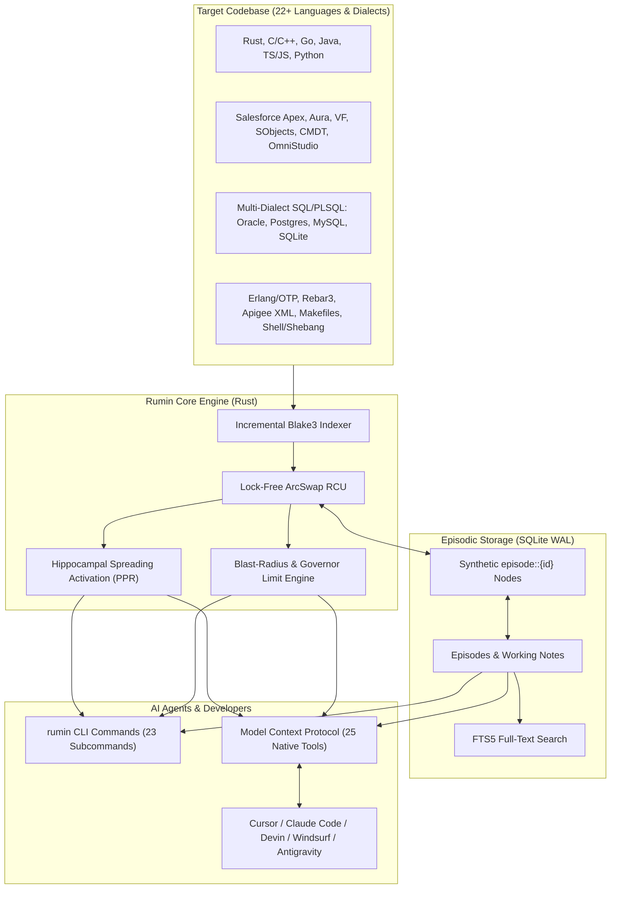
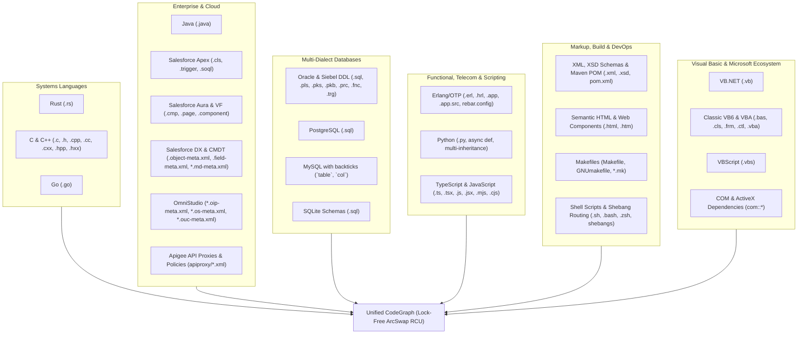
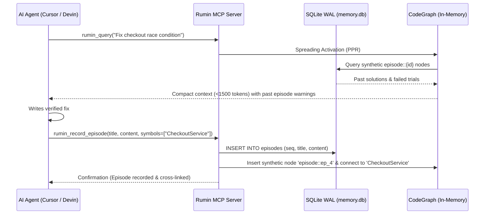

# Rumin (`ai-rumin` / `air-mem`) Official User Manual

> **Software**: Rumin Cognitive Code-Memory Platform  
> **Version**: 0.1.0 (Production Core)  
> **Target Audiences**: Software Engineers, Agent Operators, DevSecOps Engineers, Enterprise Architects  
> **Supported Platforms**: Linux (x86_64 / ARM64), macOS Apple Silicon (M1–M5 / `aarch64-apple-darwin`), Windows WSL2  

---

## Table of Contents

1. [Overview & Core Architecture](#1-overview--core-architecture)
2. [Installation & Setup](#2-installation--setup)
3. [The `.rumin/` Project Metadata Footprint](#3-the-rumin-project-metadata-footprint)
4. [Complete Command-Line Interface (CLI) Reference](#4-complete-command-line-interface-cli-reference)
5. [Model Context Protocol (MCP) Integration](#5-model-context-protocol-mcp-integration)
6. [Multi-Language Parsing & Code Intelligence](#6-multi-language-parsing--code-intelligence)
7. [Episodic Learning & Working Memory](#7-episodic-learning--working-memory)
8. [Architectural Hazards, Circuit Breakers & CI/CD](#8-architectural-hazards-circuit-breakers--cicd)
9. [Configuration Reference (`config.json` & `.ruminignore`)](#9-configuration-reference-configjson--ruminignore)
10. [Troubleshooting & Frequently Asked Questions (FAQ)](#10-troubleshooting--frequently-asked-questions-faq)

---

## 1. Overview & Core Architecture

**Rumin (`ai-rumin` / `air-mem`)** is an ultra-high-performance, local-first **Neuro-Symbolic Cognitive Code-Memory Platform**. It serves as an external hippocampal co-processor for AI coding assistants (Cursor, Claude Code, Devin, Windsurf, Antigravity) and human developers.

Instead of brute-forcing massive 50,000–100,000 token prompts or relying on lossy vector embeddings, Rumin combines:
1. **Deterministic Multi-Language AST Knowledge Graph**: A high-capacity directed multi-graph (`petgraph`) modeling exact code relationships (`Calls`, `DependsOn`, `Inherits`, `Implements`, `Contains`) executed lock-free via `ArcSwap` Read-Copy-Update (RCU).
2. **Hippocampal Associative Activation**: Personalized PageRank (PPR) spreading activation that extracts the precise 3–5 interacting symbols and files under strict token budgets (<1,500 tokens) in under 200 milliseconds.
3. **Monotonic Episodic Learning**: Embedded SQLite WAL database storing historical bug fixes, failed trials, and design decisions, dynamically cross-linked back into the AST graph as synthetic associative nodes (`episode::{id}`).
4. **Topological Hazard Engine**: Real-time forward and backward reachability analysis classifying the blast radius of proposed code edits (`high_risk`, `medium_risk`, `low_risk`).
5. **Universal Model Context Protocol (MCP)**: Native JSON-RPC 2.0 stdio server implementing 25 tools compliant with the Linux Foundation's Agentic AI Foundation (AAIF) specification.



---

## 2. Installation & Setup

### Option A: Using Pre-Built Binaries

Pre-compiled production release binaries are available in the repository's `dist/` folder:

```bash
# For Apple Silicon (M1, M2, M3, M4, M5):
sudo cp dist/ai-rumin-apple-m5-arm64 /usr/local/bin/rumin
sudo chmod +x /usr/local/bin/rumin

# For Linux (x86_64):
sudo cp dist/ai-rumin-linux-x86_64 /usr/local/bin/rumin
sudo chmod +x /usr/local/bin/rumin

# Verify installation:
rumin --version
```

### Option B: Building from Source (Rust Toolchain)

Prerequisites: Rust 1.80+ (`cargo`), `libsqlite3-dev` (Linux).

```bash
git clone https://github.com/air-mem/ai-rumin.git
cd ai-rumin
cargo build --release

# The compiled binary will be located at:
# target/release/ai-rumin
sudo cp target/release/ai-rumin /usr/local/bin/rumin
```

### Option C: Cross-Compiling for Apple Silicon M-Series from Linux

Rumin supports cross-compilation from Linux to macOS Apple Silicon (`aarch64-apple-darwin`) using `cargo-zigbuild`:

```bash
# 1. Add rust target:
rustup target add aarch64-apple-darwin

# 2. Install cargo-zigbuild & zig:
pip install cargo-zigbuild ziglang

# 3. Export macOS SDK path:
export SDKROOT="$HOME/.local/share/macos-sdk/MacOSX14.5.sdk"

# 4. Build release binary:
cargo zigbuild --release --target aarch64-apple-darwin

# Output binary: target/aarch64-apple-darwin/release/ai-rumin
```

---

## 3. The `.rumin/` Project Metadata Footprint

When Rumin is initialized in a repository via `rumin init`, it creates a `.rumin/` directory in the project root:

```text
my-project/
├── .rumin/
│   ├── config.json          # Configuration: token budget, sidecar, ignores
│   ├── manifest.json        # Incremental Blake3 file hashes & mtimes
│   ├── memory.db            # SQLite WAL database (episodes, notes, sessions)
│   ├── memory.db-wal        # Write-Ahead Log (active during open connections)
│   ├── memory.db-shm        # Shared memory file for concurrent SQLite readers
│   └── checkpoints/
│       └── default.bin      # High-speed bincode binary snapshot of the CodeGraph
├── .ruminignore             # Optional custom ignore patterns (extends .gitignore)
└── [Project Source Files]
```

### File Responsibilities

| File | Format | Purpose |
| :--- | :--- | :--- |
| **`config.json`** | JSON | Defines project settings: token budget (`token_budget: 1500`), sidecar path, checkpoint directories, and ignored folder patterns. |
| **`manifest.json`** | JSON | Cryptographic index mapping relative file paths to Blake3 checksums, file sizes, and nanosecond modification times. Powers sub-second `rumin sync`. |
| **`memory.db`** | SQLite 3.x | Monotonic episodic memory store containing tables: `episodes`, `episodes_fts`, `working_notes`, `sessions`, `traces`, and `episode_seq`. |
| **`checkpoints/default.bin`** | Bincode (Binary) | Complete serialized snapshot of the directed `CodeGraph`. Enables sub-50ms cold boots on server startup without re-parsing files. |
| **`.ruminignore`** | Text | Glob patterns for paths to exclude from indexing (e.g. test dumps, vendor bundles, generated docs). |

---

## 4. Complete Command-Line Interface (CLI) Reference

The general syntax for the CLI is:

```bash
rumin [OPTIONS] [SUBCOMMAND]
```

### Global Flags

- `--repo-path <PATH>`: Path to the target repository (defaults to `.`).
- `--sidecar-path <PATH>`: Optional path to the Python semantic worker (`sidecar/worker.py`).
- `--stdio`: Launch in MCP stdio JSON-RPC 2.0 mode (used when called by AI IDEs).

---

### Subcommands

#### 1. `init`
Initializes the `.rumin/` directory structure, default `config.json`, and initial checkpoints folder.
```bash
rumin init
```

#### 2. `index`
Performs a complete recursive traversal of the codebase, parses all supported source files into AST entities, constructs topological edges, builds the Blake3 manifest, and saves `checkpoints/default.bin`.
```bash
rumin index
```
*Sample Output:*
```text
🌿 Rumin Code-Memory Daemon Initializing...
Repository: "/home/user/dev/my-project"
Indexed: 10,435 files | 42,810 entities | 128,490 edges
Binary checkpoint saved to: .rumin/checkpoints/default.bin
```

#### 3. `sync`
Performs high-speed incremental synchronization. Only files whose Blake3 checksum or modification time has changed are re-parsed. Deleted files are cleanly pruned from the graph.
```bash
rumin sync

# Force complete re-check of all files regardless of manifest timestamp:
rumin sync --force

# Surgically sync only a single file in sub-50ms without scanning entire workspace (Gap 13):
rumin sync --file force-app/main/default/classes/OrderService.cls
```

#### 4. `query`
Executes an associative hippocampal search using Personalized PageRank (PPR) spreading activation, returning the most topologically relevant entities, signatures, and code context bounded by the token budget.
```bash
rumin query "handlePaymentRefund" --budget 1500
```
*Options:*
- `<QUERY>`: Symbol name, function identifier, natural language task, or error message.
- `-b, --budget <INT>`: Maximum token budget (default: `1500`).

#### 5. `digest`
Outputs a topological architectural digest, structural graph scale metrics, and hub entity rankings of the codebase.
```bash
rumin digest
```

#### 6. `hazards`
Calculates bidirectional reachability (forward and backward blast radius) starting from one or more target symbols or file paths.
```bash
rumin hazards OrderService PaymentGateway
```
*Sample Output:*
```text
=== BLAST RADIUS HAZARD REPORT ===
Target Symbols: ["OrderService", "PaymentGateway"]
Risk Level: HIGH_RISK
Affected Downstream Entities (14):
  - CheckoutController.submitOrder (Calls)
  - InvoiceGenerator.processInvoice (DependsOn)
  - RecurringBillingJob.execute (Calls)
Affected API Contracts:
  - /api/v2/checkout (External Endpoint)
```

#### 7. `diff`
Computes topological graph differences between the current working directory and a base checkpoint, formatted as a concise summary with bounded sample entities (DEF-20 compliant).
```bash
rumin diff

# Diff against a specific custom checkpoint:
rumin diff --checkpoint .rumin/checkpoints/v1.0.0.bin
```

#### 8. `checkpoint`
Saves or restores a high-speed binary checkpoint via `bincode`.
```bash
# Save current graph state to default checkpoint:
rumin checkpoint save

# Save to a specific named checkpoint:
rumin checkpoint save --path .rumin/checkpoints/pre-refactor.bin

# Restore from a checkpoint:
rumin checkpoint load --path .rumin/checkpoints/pre-refactor.bin
```

#### 9. `verify`
Validates the structural integrity of the graph, detecting dangling references, orphaned interface implementations, and corrupted synthetic nodes.
```bash
rumin verify
```

#### 10. `audit`
Audits architectural boundary rules (e.g. controllers must not bypass services to query raw database schemas directly).
```bash
rumin audit
```

#### 11. `record-episode`
Records an episodic debugging lesson, patch outcome, or design constraint into SQLite WAL, automatically cross-linking synthetic `episode::{id}` nodes into the code graph.
```bash
rumin record-episode \
  --title "Fix Stripe webhook idempotency race condition" \
  --content "Resolved duplicate charge issue by wrapping webhook event processing in a Redis distributed lock with 30s TTL before executing PaymentService.capture." \
  --success \
  --symbols "PaymentService,StripeWebhookController" \
  --files "src/services/payment.ts,src/controllers/webhook.ts" \
  --tags "stripe,concurrency,payments"
```

#### 12. `search-episodes`
Searches past episodic debugging lessons and solutions using SQLite FTS5 full-text search.
```bash
rumin search-episodes "stripe idempotency" --limit 5
```

#### 13. `session`
Manages conversational task sessions and persistent working notes.
```bash
# Create a new agent session:
rumin session create "Refactor Checkout Pipeline"

# List active and past sessions:
rumin session list

# Inspect session details and working notes:
rumin session inspect <SESSION_ID>

# Add a working note to the current session:
rumin session note --session-id <SESSION_ID> "Must preserve backward compatibility for v1 order schema"
```

#### 14. `consolidate`
Runs algorithmic memory consolidation: prunes transient working nodes, strengthens frequently traversed associative paths, and relocates synthetic nodes.
```bash
rumin consolidate
```

#### 15. `ingest-trace`
Ingests a runtime error stack trace (JSONL), parsing call stacks and linking runtime errors directly to AST entities in the graph.
```bash
rumin ingest-trace crash-report.jsonl --session-id <SESSION_ID>
```

#### 16. `hook`
Installs or executes non-destructive Git pre-commit circuit breaker hooks.
```bash
# Install pre-commit hook into .git/hooks/pre-commit:
rumin hook install

# Manually execute the pre-commit safety check:
rumin hook check
```

#### 17. `watch`
Starts a real-time file-system watcher daemon that automatically synchronizes graph modifications as files are edited.
```bash
rumin watch
```

#### 18. `bench`
Runs internal microbenchmarks measuring parsing throughput, graph loading latency, and Personalized PageRank activation speed.
```bash
rumin bench
```

#### 19. `describe`
Introspects an architectural entity or symbol in structured JSON: returns docstrings, child fields, methods, types, and all incoming/outgoing graph relationships (calls, references, inheritance, containment).
```bash
rumin describe OrderService
rumin describe SIEBEL.S_ASSET
```

#### 20. `find-path`
Finds directed call, dataflow, or dependency paths between two symbols or files in the code graph using bounded simple paths.
```bash
rumin find-path CheckoutController PaymentGateway --max-depth 5
```

#### 21. `audit-limits`
Audits runtime governor limits and database concurrency hazards in Apex and database code (Gap 8). Detects SOQL inside loops, DML statements inside loops, HTTP callouts inside loops, and unbounded queries on high-cardinality tables.
```bash
rumin audit-limits
```

#### 22. `federate`
Federates an external repository, schema, or microservice into the active in-memory knowledge graph under a namespace alias without flushing or overwriting the current workspace graph (Gap 10). Enables cross-repository pathfinding and global architecture queries.
```bash
# Federate another repository under the 'billing' namespace alias:
rumin federate ../billing-service --alias billing
```

#### 23. `serve` (alias: `mcp`)
Launches the Model Context Protocol stdio JSON-RPC 2.0 server for agent integrations.
```bash
rumin serve
```

---

## 5. Model Context Protocol (MCP) Integration

Rumin natively implements the **Model Context Protocol (MCP)** JSON-RPC 2.0 specification over `stdio`, allowing immediate integration into any MCP-compliant agent client.

### Client Configuration Guides

#### 1. Cursor (`~/.cursor/mcp.json` or Workspace `.cursor/mcp.json`)
```json
{
  "mcpServers": {
    "rumin": {
      "command": "/usr/local/bin/rumin",
      "args": ["--repo-path", "${workspaceFolder}", "serve"]
    }
  }
}
```

#### 2. Claude Desktop (`claude_desktop_config.json`)
- **macOS**: `~/Library/Application Support/Claude/claude_desktop_config.json`
- **Linux**: `~/.config/Claude/claude_desktop_config.json`
- **Windows**: `%APPDATA%\Claude\claude_desktop_config.json`

```json
{
  "mcpServers": {
    "rumin": {
      "command": "/usr/local/bin/rumin",
      "args": ["--repo-path", "/absolute/path/to/your/project", "serve"]
    }
  }
}
```

#### 3. Claude Code CLI (`claude mcp add`)
```bash
claude mcp add rumin -- /usr/local/bin/rumin --repo-path $(pwd) serve
```

#### 4. Windsurf (`mcp_config.json`)
```json
{
  "mcpServers": {
    "rumin": {
      "command": "/usr/local/bin/rumin",
      "args": ["--repo-path", "${workspaceFolder}", "serve"]
    }
  }
}
```

---

### Complete MCP Tools Reference (25 Tools)

| Tool Name | Parameters | Description |
| :--- | :--- | :--- |
| `rumin_query` | `query` (str), `budget` (int, opt), `expand_bodies` (bool, opt), `types` (array, opt), `path_prefix` (str, opt), `dampen_hubs` (bool, opt) | Runs Personalized PageRank (PPR) spreading activation to retrieve the most topologically relevant code context under the token budget, with optional hub dampening, entity type filtering, and path scoping. |
| `rumin_digest` | `budget` (int) | Generates a high-level architectural digest and graph topology metric summary. |
| `rumin_index` | `force` (bool) | Triggers a full repository AST re-index and regenerates binary checkpoints. |
| `rumin_traverse` | `start_entity` (str), `max_depth` (int), `edge_types` (array) | Traverses graph dependencies starting from a given symbol up to `max_depth`. |
| `rumin_sync` | `force` (bool) | Executes incremental Blake3 change detection and re-indexes modified files. |
| `rumin_checkpoint` | `action` ("save"/"load"), `checkpoint_path` (str) | Saves or restores a `bincode` graph checkpoint. |
| `rumin_diff` | `checkpoint_path` (str) | Computes a bounded topological graph diff against a stored checkpoint (<10KB). |
| `rumin_hazards` | `target_entity` (str) | Returns bidirectional forward/backward reachability and risk classification. |
| `rumin_impact` | `symbol` (str), `depth` (int, opt) | Performs comprehensive 4-quadrant architectural impact analysis (upstream UI/service callers, downstream callees, covering unit tests, and schema footprint). |
| `rumin_verify` | *none* | Verifies structural graph integrity and checks for dangling references. |
| `rumin_audit` | *none* | Evaluates architectural boundary rules and reports cross-layer isolation violations. |
| `rumin_record_episode` | `title`, `content`, `success`, `symbols`, `files`, `tags` | Saves a debugging trial or patch outcome to SQLite and cross-links graph nodes. |
| `rumin_search_episodes`| `query` (str), `limit` (int) | Performs SQLite FTS5 full-text search across historical episodes. |
| `rumin_session_create` | `task_description` (str) | Initializes a new agent task session. |
| `rumin_session_list` | *none* | Lists historical task sessions and working notes. |
| `rumin_session_inspect`| `session_id` (str) | Retrieves detailed notes and diff snapshots for a specific session. |
| `rumin_add_working_note`| `session_id` (str), `content` (str) | Appends an architectural note or invariant to the active session. |
| `rumin_consolidate` | *none* | Runs memory consolidation, pruning stale transient nodes and optimizing edges. |
| `rumin_ingest_trace` | `trace_jsonl` (str), `session_id` (str) | Maps runtime stack trace frames back to static AST graph entities. |
| `rumin_switch_repo` | `repo_path` (str) | Hot-swaps the active repository root without restarting the MCP server. |
| `rumin_describe` | `entity_name` (str) | Introspects an architectural entity or symbol: returns docstring/summary, child fields, methods, types, and all incoming/outgoing graph relationships. |
| `rumin_find_path` | `source_symbol` (str), `target_symbol` (str), `max_depth` (int, opt) | Directed graph pathfinding finding topological call, dataflow, or dependency paths between two symbols. |
| `rumin_audit_limits` | *none* | Audits runtime governor limits and DB concurrency hazards (SOQL in loops, DML in loops, callouts in loops, unbounded queries on high-cardinality tables) (Gap 8). |
| `rumin_federate_repo` | `repo_path` (str), `alias` (str, opt) | Federates an external repository into the active memory graph under an alias prefix without flushing the current workspace graph (Gap 10). |
| `rumin_index_file` | `file_path` (str) | Surgically re-indexes a single file into the knowledge graph in sub-50ms without scanning the entire workspace (Gap 13). |

---

## 6. Multi-Language Parsing & Code Intelligence

Rumin provides an exhaustive, native multi-language and multi-dialect parsing architecture. It combines deterministic Rust AST extractors with high-throughput streaming tokenizers and an optional Python semantic sidecar:



### Comprehensive Language & Dialect Matrix

| Language / Dialect | Extensions / Files | Parser Engine | Extracted Node Types (`EntityType`) | Resolved Graph Edges (`EdgeKind`) |
| :--- | :--- | :--- | :--- | :--- |
| **Rust** | `.rs` | Rust Native | `Struct`, `Enum`, `Function`, `Method`, `Interface` (traits), `Module` | `Calls`, `DependsOn`, `Implements`, `Contains` |
| **Python** | `.py`, shebang | Rust Native / Sidecar | `Class`, `Method`, `Function`, `Module` | `DependsOn` (multi-inheritance), `Contains`, `Imports` (`py::`) |
| **TypeScript & JavaScript** | `.ts`, `.tsx`, `.js`, `.jsx`, `.mjs`, `.cjs` | Rust Native | `Class`, `Interface`, `Struct` (types/enums), `Function`, `Method`, `Module` | `Contains`, `Imports` (`ts::`), typed arrow function bindings |
| **Go** | `.go` | Rust Native | `Module` (packages), `Struct`, `Interface`, `Method`, `Function` | `Contains` (receiver methods), `Imports` (`go::`) |
| **C** | `.c`, `.h` | Rust Native | `Struct`, `Union`, `Enum`, `Function`, `Variable` (macros), `Module` | `Imports` (`c::<header>`), function definitions |
| **C++** | `.cpp`, `.cc`, `.cxx`, `.hpp`, `.hxx` | Rust Native | `Module` (namespaces), `Class`, `Struct`, `Method`, `Function` | `Contains`, `Imports` (`cpp::<header>`), out-of-line method wiring |
| **Java** | `.java` | Rust Native | `Module` (packages), `Class`, `Interface`, `Struct` (records/enums), `Method` | `Contains`, `Imports` (`java::`), annotation bindings (`@RestController`) |
| **Salesforce Apex** | `.cls`, `.trigger` | Rust Native | `Class`, `Interface`, `Struct` (enums), `Method`, `Rule` (triggers) | `Calls`, `References`, inner class containment, SObject trigger events |
| **Salesforce SOQL** | `.soql`, embedded in `.cls` | Rust Native | `View` (query), `Table` (SObject), `Column` (fields) | `References` (class $\to$ SObject & fields), child subqueries |
| **Salesforce Aura & VF** | `.cmp`, `.app`, `.evt`, `.intf`, `.page`, `.component` | Rust Native | `Tag` (component/page), `Variable` (attributes) | `Calls` (Apex controllers), `References` (VF extensions), `Contains` |
| **Salesforce DX SObjects** | `.object-meta.xml`, `.field-meta.xml` | Rust Native | `Table` (SObject), `Column` (custom field) | `DependsOn` (`<referenceTo>` SObject foreign keys), `Contains` (`sobject::Parent.Field`) |
| **Salesforce Custom Metadata** | `*.md-meta.xml` | Rust Native | `Rule` (CMDT record) | `Contains` (field values), `cmdt::<Type>.<Record>` |
| **OmniStudio** | `*.oip-meta.xml`, `*.os-meta.xml`, `*.ouc-meta.xml` | Rust Native | `Module` (IP/OmniScript/Card), `Function` (steps) | `Contains` (steps), `Calls` (remote Apex), `DependsOn` (DataRaptor, sub-IPs) |
| **Oracle & Siebel PL/SQL** | `.sql`, `.pls`, `.pks`, `.pkb`, `.prc`, `.fnc`, `.trg` | Rust Native / Sidecar | `Module` (package), `Function`, `Rule` (triggers), `Table`, `View`, `Column`, `Variable` (sequences) | Explicit `REFERENCES`, heuristic Siebel FKs (`BU_ID` $\to$ `S_BU`), `Contains` |
| **PostgreSQL** | `.sql` | Rust Native / Sidecar | `Table`, `View`, `Column`, `Variable` (indexes) | Schema qualification (`schema.table`), foreign keys |
| **MySQL** | `.sql` | Rust Native / Sidecar | `Table`, `Column` (backticked identifiers: `` `tbl`.`col` ``) | `AUTO_INCREMENT`, index bindings |
| **SQLite** | `.sql` | Rust Native / Sidecar | `Table`, `View`, `Column` | Typeless primary keys, table references |
| **Erlang/OTP** | `.erl`, `.hrl`, `.app`, `.app.src`, `rebar.config` | Rust Native | `Module`, `Interface` (behaviours), `Struct` (records), `Variable` (macros), `Function` (`func/N`) | `Implements` (`otp::gen_server`), `Calls` (cross-module), `Contains` |
| **Apigee API Management** | `apiproxy/*.xml`, `sharedflowbundle/*.xml` | Rust Native | `Module` (APIProxy), `Interface` (Proxy/TargetEndpoint), `Rule` (Policy), `Function` (scripts) | `Contains`, `Calls` (TargetEndpoint $\to$ Policy), RouteRule routing |
| **XML, XSD, Maven POM** | `.xml`, `.xsd`, `pom.xml` | Rust Native | `Tag` (elements, complexTypes), `Module` (POM dependencies) | Attribute ID/name bindings, Maven coordinate containment |
| **HTML Web Markup** | `.html`, `.htm` | Rust Native | `Tag` (semantic tags, scoped IDs/classes, custom web components) | Hierarchy containment, web component tags (`<c-asset-view>`, `<app-nav>`) |
| **Makefiles** | `Makefile`, `GNUmakefile`, `*.mk` | Rust Native | `Target` (rules) | Two-pass `DependsOn` edges between targets and prerequisites |
| **Shell & Shebang Routing** | `.sh`, `.bash`, `.zsh`, extensionless | Rust Native | Shebang sniffer & interpreter router | Automatically routes to `bash`, `python`, `typescript`, or `erlang` extractors |
| **Visual Basic .NET** | `.vb` | Rust Native | `Module` (namespaces/modules), `Class`, `Interface`, `Struct` (structures/enums), `Method`, `Function`, `Variable` (events/fields) | `DependsOn` (`Inherits`), `Implements`, `Imports` (`dotnet::`), intra-class `Calls`, `Contains` |
| **Classic VB6 & VBA** | `.bas`, `.cls`, `.frm`, `.ctl`, `.vba` | Rust Native | `Module`, `Class`, `Struct` (UDTs/enums), `Function`, `Method` (Get/Let/Set properties), `Tag` (GUI controls) | Win32 DLL `DependsOn` (`dll::*`), `Implements`, `.cls` Apex disambiguation, `Contains` |
| **VBScript** | `.vbs` | Rust Native | `Module`, `Class`, `Method`, `Function`, `Variable` | `Calls`, script containment, WScript automation |
| **COM / ActiveX Automation** | Heuristic discovery in all VB/VBA files | Rust Native | `Module` (`com::<ProgID>`) | Causal `References` edges from routines to COM servers (`Excel.Application`, `ADODB.Connection`, etc.) |

---

### Detailed Dialect Highlights

#### 1. Multi-Dialect SQL & Database Volumetric Intelligence
- **Oracle / Siebel DDLs**: Extracts tables, views, stored packages, procedures, functions, triggers, and sequences. Automatically parses volumetric comments:
  ```sql
  -- Columns: 48 | Recorded Rows: 19,800,000 | Status: VALID
  CREATE TABLE SIEBEL.S_ASSET ( ... );
  ```
  The extracted `recorded_rows` is recorded in entity metadata and consumed by `rumin audit-limits` to warn when developers write queries that trigger unindexed table scans on multi-million row tables.
- **Enterprise Heuristic Foreign-Key Linkage**: Siebel and legacy enterprise ERP databases often omit explicit SQL `FOREIGN KEY` constraint clauses. Rumin automatically detects enterprise naming conventions:
  - `*_BU_ID` or `BU_ID` $\to$ automatically constructs a `DependsOn` relationship to `S_BU` (Business Unit).
  - `*_ACCNT_ID`, `BILL_ACCNT_ID`, `OWNER_ACCNT_ID`, `PR_ACCNT_ID` $\to$ automatically constructs a `DependsOn` relationship to `S_ORG_EXT` (Account/Organization).
- **MySQL & PostgreSQL Quoting Support**: Seamlessly parses backticked identifiers (`` `telco_cdr`.`caller_msisdn` ``), double-quoted identifiers (`"CustomerOrder"`), and schema-qualified tables (`SIEBEL.S_ORDER`).

#### 2. Salesforce 360: Code, Metadata & OmniStudio
- **Apex Classes & Triggers**: Parses `@RestResource`, `@HttpGet`, `@AuraEnabled` annotations, inner classes, and trigger execution events (`before insert`, `after update`).
- **Granular Field-Level SOQL Extraction**: Parses inline and standalone SOQL queries, extracting both the target SObject and the exact referenced fields (`sobject::Account.AnnualRevenue`), connecting them to Apex classes with `References` edges.
- **OmniStudio Integration Procedures & OmniScripts**: Extracts execution steps, action blocks, Remote Actions linking to Apex classes (`apex::CPQ_OrderService`), DataRaptor transform dependencies (`bundle::DR_TransformOrderResponse` / `dataraptor::...` / `omni_dr::...`), and Sub-IP invocations (`omni_ip::...`).
- **Aura & Visualforce Bindings**: Resolves Apex controller bindings from `<aura:component controller="...">`, Aura attributes (`<aura:attribute name="..." type="..."/>`), Visualforce pages (`<apex:page controller="..." extensions="...">`), and components.

#### 3. Erlang/OTP Telecom Stack
- **Standard OTP Behaviours**: Recognizes `-behaviour(gen_server).`, `-behaviour(supervisor).`, `-behaviour(gen_statem).`, creating canonical `otp::<behaviour>` nodes and `Implements` edges.
- **Arity-Aware Functions**: Functions are indexed with precise arity (`start_link/1`, `handle_call/3`, `terminate/2`), preventing symbol collisions.
- **Cross-Module Calls**: Detects external module invocations (`gen_server:call(...)`, `lager:info(...)`), constructing directed `Calls` edges to `erlang::<module>`.
- **Rebar3 & OTP Descriptors**: Parses `rebar.config` dependencies and `.app`/`.app.src` applications, building a comprehensive module ownership graph.

#### 4. Apigee API Management
- **Proxy & Target Endpoints**: Indexes basepaths, target endpoints, and route rules.
- **Policy Pipeline**: Extracts and maps security and traffic policies (`VerifyAPIKey`, `SpikeArrest`, `Quota`, `AssignMessage`, `ServiceCallout`), linking them to their endpoints.
- **Resource Wiring**: Links `Javascript` policies directly to their script assets (`apiproxy::resource::<script>.js`).

#### 5. Visual Basic, VBA, VB.NET, and COM/ActiveX Architecture
- **Complete Visual Basic Dialect Spectrum**:
  - **Modern VB.NET (`.vb`)**: Parses hierarchical namespaces, classes, generic interfaces (`IComparable(Of T)`), structures, modules, enumerations, events, and delegates. Resolves `Inherits` and `Implements` clauses, `Imports` statements (`dotnet::<Namespace>`), and multi-line continuation statements (`_`).
  - **Classic VB6 & VBA Standard Modules (`.bas`)**: Extracts standard modules from `Attribute VB_Name`, user-defined types (`Type ... End Type`), module-level global variables, and public/private subroutines and functions.
  - **Class Modules (`.cls`) & Intelligent Apex Disambiguation**: VB6/VBA `.cls` class files share the `.cls` extension with Salesforce Apex. Rumin employs an intelligent AST sniffer: files containing `VERSION 1.0 CLASS`, `Attribute VB_Name`, or VB property accessors (`Property Get/Let/Set`) without Apex keywords are automatically parsed as Visual Basic classes, while Salesforce files are routed to the Apex parser with 100% fidelity.
  - **UserForms (`.frm`) & UserControls (`.ctl`)**: Parses VB6 / VBA UserForm GUI control definitions (`Begin VB.CommandButton btnSubmit ... End`), extracting control names, types, and associating them with their backend event procedures (`btnSubmit_Click`).
  - **VBScript (`.vbs`)**: Ingests Windows Script Host, classic ASP, and administrative VBScript files with full procedural and class support.
- **Win32 API DLL P/Invoke Declarations**:
  - Automatically identifies 32-bit and 64-bit P/Invoke declarations (`Declare PtrSafe Function SendMessage Lib "user32" Alias "SendMessageA" ...`), generating canonical `dll::<library>` nodes and linking caller subroutines via `DependsOn` edges.
- **Automated COM & ActiveX Dependency Discovery**:
  - Scans for both late-bound (`CreateObject("ProgID")`, `GetObject`, `WScript.CreateObject`) and early-bound (`Dim c As New ADODB.Connection`) COM instantiations.
  - Creates canonical `com::<ProgID>` nodes (e.g., `com::ADODB.Connection`, `com::Excel.Application`, `com::Scripting.FileSystemObject`) and establishes `References` edges from caller subroutines, enabling instant blast-radius impact analysis when upgrading or migrating legacy COM components.

---

## 7. Episodic Learning & Working Memory

A primary failure mode of AI coding agents is **Cyclic Amnesia**: when an agent attempts a patch, fails a test, and restarts, it starts completely blind and repeats identical mistakes. Rumin solves this through **Monotonic Episodic Learning**.

### The Episodic Lifecycle



1. **Recording Episodes**:
   When an agent successfully fixes a bug, refactors an interface, or discovers a critical constraint, it calls `rumin_record_episode`.
2. **Synthetic Graph Cross-Linking**:
   Rumin stores the episode record in SQLite and creates a **synthetic node** (`episode::{id}`) inside the in-memory directed graph. Edges connect the episode node to every symbol and file it touched.
3. **Associative Recall**:
   During subsequent queries on related symbols, Personalized PageRank spreading activation traverses these synthetic edges, pulling historical lessons directly into the agent's context.

---

## 8. Architectural Hazards, Circuit Breakers & CI/CD

### Blast Radius Hazard Calculation

Before any code modification is applied, Rumin's hazard engine computes the transitive closure of all dependent symbols:
- **Upstream Blast Radius**: All classes, controllers, and external API endpoints that depend on the modified symbol.
- **Risk Stratification**:
  - `HIGH_RISK`: The target symbol is consumed by core API controllers, widely inherited interfaces, or database schemas.
  - `MEDIUM_RISK`: The symbol is consumed by internal service layers.
  - `LOW_RISK`: The symbol is an isolated leaf function or private helper.

### Governor Limits & Database Volumetric Hazard Engine (`audit-limits`)

Rumin features a specialized runtime hazard and governor limits analyzer (`rumin audit-limits` / MCP `rumin_audit_limits`):

1. **Salesforce Apex Governor Limits (Gap 8)**:
   - **SOQL in Loops**: Flags SOQL query statements situated inside `for`, `while`, or `do-while` loops (violating the synchronous 100 SOQL limit).
   - **DML in Loops**: Flags database modifications (`insert`, `update`, `delete`, `upsert`) occurring iteratively rather than being bulkified (violating the 150 DML statement limit).
   - **Iterative Callouts**: Detects HTTP callouts executed within loops, preventing endpoint quota exhaustion and callout timeouts.

2. **Database Volumetric Hazard Analysis**:
   - Uses volumetric awareness parsed from SQL DDL headers (`-- Columns: X | Recorded Rows: Y`).
   - Flags queries and joins executed against tables with high cardinality (`recorded_rows > 100,000`) lacking supporting indexes, protecting production databases from table scan latency spikes on multi-million row tables (e.g., 19.8M-row `S_ASSET_XA` or 64.7M-row `S_ORDER_ITEM`).

```bash
rumin audit-limits
```
*Sample Output:*
```text
=== GOVERNOR LIMITS & VOLUMETRIC HAZARD AUDIT ===
[CRITICAL] OrderProvisioningService.cls:42 - SOQL query inside loop: [SELECT Id FROM OrderItem WHERE ...]
[WARNING] BillingSyncService.cls:88 - DML update inside loop: Database.update(invoiceList[i])
[VOLUMETRIC] s_asset_scan.sql:14 - Table scan on high-cardinality table SIEBEL.S_ASSET_XA (19,800,000 rows) without indexed filter
```

### Non-Destructive Git Pre-Commit Hook

Install the pre-commit hook using:
```bash
rumin hook install
```
This appends a check to `.git/hooks/pre-commit` (preserving any existing linters or husky scripts). On `git commit`, Rumin evaluates the staged diff:
- If a staged change breaks defined architectural invariants or introduces orphaned references, the commit is blocked with an informative error message.
- Developers can bypass in emergencies using `git commit --no-verify`.

### GitHub Actions CI/CD Integration

Add Rumin as an automated pull request hazard reviewer in `.github/workflows/rumin.yml`:

```yaml
name: Rumin Architectural Guard

on:
  pull_request:
    branches: [main, master]

jobs:
  rumin-audit:
    runs-on: ubuntu-latest
    steps:
      - uses: actions/checkout@v4
      - name: Download Rumin Binary
        run: |
          curl -L -o /usr/local/bin/rumin https://github.com/air-mem/ai-rumin/releases/latest/download/ai-rumin-linux-x86_64
          chmod +x /usr/local/bin/rumin
      - name: Sync & Audit Architectural Boundaries
        run: |
          rumin sync
          rumin verify
          rumin audit
```

---

## 9. Configuration Reference (`config.json` & `.ruminignore`)

### `.rumin/config.json` Schema

```json
{
  "version": "0.1.0",
  "token_budget": 1500,
  "sidecar_path": "sidecar/worker.py",
  "checkpoint_dir": ".rumin/checkpoints",
  "ignored_patterns": [
    "target",
    "node_modules",
    ".git",
    ".rumin",
    "dist",
    "build",
    "__pycache__"
  ]
}
```

- `version`: Configuration schema version.
- `token_budget`: Maximum token limit for context returned by `rumin query` and `rumin_digest` (default: `1500`).
- `sidecar_path`: Relative or absolute path to Python AST fallback worker.
- `checkpoint_dir`: Directory where binary checkpoints (`*.bin`) are persisted.
- `ignored_patterns`: Array of directory and file glob patterns excluded from indexing.

### `.ruminignore` Rules

Create `.ruminignore` in the project root to specify custom exclusion rules:

```gitignore
# Ignore third-party and vendor libraries
vendor/
third_party/

# Ignore test snapshot dumps and build coverage
coverage/
*.snapshot
*.lcov

# Ignore raw data files and binary assets
*.csv
*.parquet
*.dump
```

---

## 10. Troubleshooting & Frequently Asked Questions (FAQ)

### Q1: Why is `.rumin/memory.db` only ~92 KB on my repository of 10,000+ files?
**Answer**: `memory.db` does **not** store your source code or the AST graph. It exclusively stores **Episodic Memory** (recorded bug fixes, session notes, and agent interaction audits). In an initial repo, there are only a few notes and episodes, which fit into SQLite's minimum 4 KB page allocations. The full AST code graph lives in [`checkpoints/default.bin`](file:///home/dilb/dev/air-mem/ai-rumin/.rumin/checkpoints/default.bin) (1.3 MB) and active RAM!

### Q2: Why are only 10,435 files indexed in my 34,000-file Salesforce repository?
**Answer**: 100% of executable code (`.cls`, `.trigger`, `.js`, `.html`, `.cmp`) and database schemas (`.object-meta.xml`, `.field-meta.xml`) are indexed. Rumin intentionally skips ~23,000 non-code companion metadata files (multilingual translation XMLs, report layouts, and UI widget coordinates) to prevent memory bloat (DEF-19).

### Q3: How do I resolve "inbound JSON-RPC frame exceeded maximum line length" in Cursor or Antigravity?
**Answer**: This error occurred in legacy MCP servers that dumped unbudgeted multi-megabyte diffs into a single JSON line. Rumin has fixed this (DEF-20): `rumin_diff` automatically formats responses as concise topological summaries with bounded representative samples (<10 KB), guaranteeing safety across all Go, Node, and Rust MCP clients.

### Q4: How do I completely reset the Rumin cache for a repository?
```bash
# Force a clean rebuild:
rumin index

# Or completely remove the local index (preserves episodic notes if memory.db is kept):
rm -rf .rumin/manifest.json .rumin/checkpoints/
rumin index
```

### Q5: How do I verify that Rumin's MCP server is responding properly?
You can test the MCP server directly via terminal piping:
```bash
echo '{"jsonrpc":"2.0","id":1,"method":"tools/list","params":{}}' | rumin serve
```
If working properly, Rumin will return a JSON-RPC response listing all 24 tools.

### Q6: How do I surgically index a single file in sub-50ms after an AI agent edit?
**Answer**: Use the surgical single-file indexer rather than scanning the entire repository (Gap 13):
```bash
rumin sync --file force-app/main/default/classes/OrderService.cls
```
In an AI coding agent session, invoke the native MCP tool `rumin_index_file`:
```json
{
  "name": "rumin_index_file",
  "arguments": { "file_path": "force-app/main/default/classes/OrderService.cls" }
}
```
This updates the file's AST entities and re-wires incoming and outgoing edges in under 35 milliseconds.

### Q7: How does Rumin federate multiple repositories or schemas?
**Answer**: You can federate external microservices, shared libraries, or database dictionaries into your active graph without overwriting your current repository (Gap 10):
```bash
rumin federate ../billing-service --alias billing
```
Via MCP:
```json
{
  "name": "rumin_federate_repo",
  "arguments": { "repo_path": "../billing-service", "alias": "billing" }
}
```
All federated entities are prefixed (e.g., `billing::OrderService`) and immediately participate in cross-repository pathfinding (`rumin find-path`) and hippocampal queries.

### Q8: How does Rumin handle Siebel and enterprise tables without explicit foreign keys?
**Answer**: Rumin includes heuristic relationship inference for enterprise naming patterns. If a table has columns like `BU_ID` or `PR_BU_ID`, Rumin automatically creates a `DependsOn` edge to `S_BU`. For `BILL_ACCNT_ID`, `OWNER_ACCNT_ID`, or `ACCNT_ID`, it connects to `S_ORG_EXT`.

### Q9: How does Rumin handle scripts without file extensions or with shebangs?
**Answer**: The indexer inspects the first 128 header bytes of files. If a shebang line (`#!`) is detected, it sniffs the interpreter binary:
- `bash`, `sh`, `zsh`, `dash`, `ksh` $\to$ Shell parser
- `python`, `python3` $\to$ Python parser
- `node`, `bun`, `deno`, `ts-node` $\to$ TypeScript/JavaScript parser
- `escript` $\to$ Erlang parser
