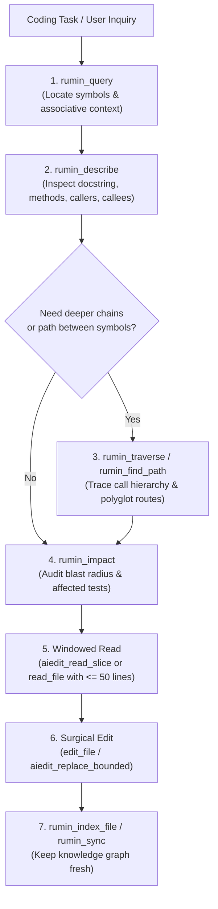

# Global Agent Guidelines: Rumin-First Code Intelligence & Navigation

> [!IMPORTANT]
> **MANDATORY CODE NAVIGATION PROTOCOL**:
> This environment is powered by **Rumin** (`ai-rumin`), a high-performance AST & knowledge-graph code intelligence engine.
> Whenever you need to explore, search, understand, trace, or modify code in ANY project or workspace, you **MUST ALWAYS use Rumin tools FIRST** before using basic shell utilities (`grep`, `find`) or reading raw files.

---

## 1. The Rumin-First Code Exploration Workflow

Follow this multi-step pipeline for all coding tasks:

---

## 2. Core Tool Instructions

### A. Discovery: `rumin_query` (MCP) / `ai-rumin query` (CLI)
* **When to use**: Searching for any symbol, function, class, API, configuration, or architectural concept.
* **Why**: Rumin uses Personalized PageRank over the AST knowledge graph, returning ranked entities, file paths, line ranges, and surrounding context in $O(1)$ token budgets without wasting context window tokens.
* **Parameters**:
  * `query`: Natural language or symbol name (e.g. `"authentication token refresh"`, `"InvoiceService"`).
  * `budget`: Max tokens (default 1500).
  * `expand_bodies`: `true` to include AST code slices directly in the query response.

### B. Introspection: `rumin_describe` (MCP) / `ai-rumin describe` (CLI)
* **When to use**: Understanding what a symbol (class, method, interface, struct, table) does.
* **Why**: Returns the docstring, child fields, methods, incoming callers, and outgoing dependencies immediately without reading hundreds of lines of implementation code.
* **Parameters**:
  * `entity_name`: Symbol name or qualified ID (e.g. `"PaymentProcessor"`, `"authenticate_user"`).

### C. Call Chains & Polyglot Routing: `rumin_traverse` & `rumin_find_path`
* **When to use**:
  * Tracing who calls a function or what a function calls: `rumin_traverse(symbol_id="...", direction="callers"|"callees", depth=1..3)`.
  * Finding architectural connection between two distant components across polyglot boundaries (e.g., UI frontend to database table): `rumin_find_path(source_symbol="...", target_symbol="...")`.

### D. Safety & Blast Radius: `rumin_impact` (MCP) / `ai-rumin impact` (CLI)
* **When to use**: **Mandatory before editing or refactoring existing code.**
* **Why**: Generates a 4-quadrant impact matrix:
  1. **Upstream Callers**: Direct and indirect callers that will be affected.
  2. **Downstream Dependencies**: What this component depends on.
  3. **Covering Tests**: Unit/integration tests that exercise this symbol.
  4. **Schema Footprint**: Database tables/fields touched.

### E. Surgical Code Reading & Editing
* Once Rumin identifies the exact file and line ranges:
  * Use `aiedit_read_slice` or `read_file` with explicit `StartLine` and `EndLine` (maximum 50-60 lines).
  * Never read entire files.
  * After editing, run `rumin_index_file(path="<file>")` or `rumin_sync()` to update the graph.

---

## 3. Strict Prohibitions

1. **DO NOT** run blind recursive searches (`grep -r`, `ripgrep`, `find .`, `ls -R`) to find symbols or code logic. Always run `rumin_query` first.
2. **DO NOT** read entire source code files via `read_file` or terminal dumps (`cat`, `bat`, `less`). Large reads waste tokens and will be intercepted.
3. **DO NOT** modify shared interfaces, methods, or database structures without running `rumin_impact` first.
